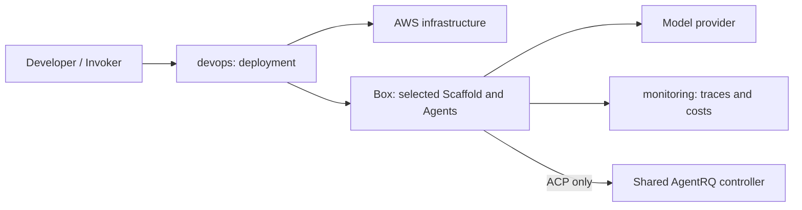

# CRUX in a box

Deploy autonomous agents to EC2, run tasks, and inspect their work. Supported
Scaffolds are Agents SDK and AgentRQ/ACP with Codex or Claude.

> [!NOTE]
> This code is set up specifically to support [CRUX](https://cruxevals.com/) evaluations.
> We strongly encourage you to remix, adapt, and reuse this scaffold to conduct
> your own CRUX-style experiments, and to meet your specific research goals.

## Prerequisites

AWS deployment requires an authenticated explicit AWS profile and the tools
listed in the [DevOps runbook](devops/README.md). Provider credentials and private
Run configuration stay outside Git. Development uses Python 3.12 and the selected
component's dependencies.

## Getting started

1. Follow [DevOps](devops/README.md) to prepare and deploy a Run.
2. Use the selected [Scaffold](scaffolds/README.md) to begin and observe it.
3. Preserve the results before following the teardown instructions.

## Development

Install the dependencies in each component's Development section before running
its tests. From the repository root, shared checks are:

```sh
python -m pip install -r requirements-dev.txt
python -m ruff check .
python -m pytest -q
```

The full suite needs all component dependencies and disposable PostgreSQL; see
[monitoring](monitoring/service/README.md#development),
[SDK](scaffolds/sdk/README.md#development) and
[tracing](monitoring/tracing/tests/README.md#development). CI scans complete PR
commit ranges with TruffleHog.

## Layout

| Directory | Purpose |
| --- | --- |
| [devops/](devops/README.md) | Shared environment provisioning and operations. |
| [scaffolds/](scaffolds/README.md) | Agent execution environments and environment-specific experiment inputs. |
| [monitoring/](monitoring/README.md) | Run observation, costs, status, and incident assessment. |
| [utilities/](utilities/README.md) | Support tools used independently of deployment. |

## System design

CRUX deploys a task to a remote execution environment and records its results.
The Invoker runs on the developer's machine; task execution continues on the
Box after the Invoker exits. See [Terminology](#terminology) for shared terms.



`devops/` owns infrastructure and configuration; `scaffolds/` defines and
orchestrates Agents using tools, context, prompts and steering interfaces;
`monitoring/` owns observations; `utilities/` contains support tools. Each
component owns its tests and dependencies.

An AgentRQ controller has an independent lifecycle from its workspaces and Run
Boxes. SDK Runs do not require it. Auxiliary resources can outlive a Run, so their
ownership and deletion policy must be explicit rather than inferred from a Box name.

## Terminology

| Term | Meaning |
| --- | --- |
| Box | Remote execution environment, normally EC2. |
| Run | Execution of a CRUX task on a Box. |
| Scaffold | The "runtime" of the agent, including defining subagents, providing tools, context, and steering interfaces. E.g., Claude Code, Codex, Agent SDK |
| Invoker | Environment from which deployment and Run are invoked. |
| Harness | The combination of the aforementioned components and necessary inputs/configurations (prompts, context, tools) for a specific Run. |
