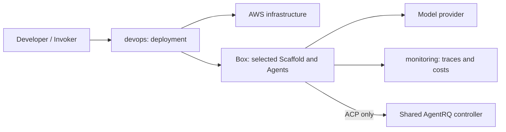

# System design

CRUX deploys a task to a remote execution environment and records its results.
The Invoker runs on the developer's machine; task execution continues on the
Box after the Invoker exits. Shared terms are defined in the
[README](README.md#terminology).

`devops/` owns infrastructure and configuration; `scaffolds/` defines and
orchestrates Agents using tools, context, prompts and steering interfaces;
`monitoring/` owns observations; `utilities/` contains support tools. Each
component owns its tests and dependencies.

An AgentRQ controller has an independent lifecycle from its workspaces and Run
Boxes. SDK Runs do not require it. Auxiliary resources can outlive a Run, so their
ownership and deletion policy must be explicit rather than inferred from a Box name.

The temporary Terraform path link supports trusted default-branch PR planning.

The [DevOps design](devops/design.md) documents the four-phase Invoker, single Run
configuration and separate explicit start.
