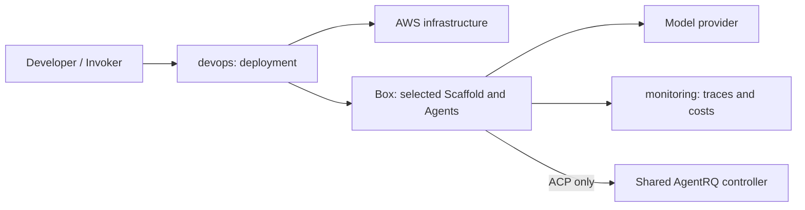

# System design

CRUX deploys a research task to a remote execution environment and records its
results. The Invoker runs on the developer's machine; research continues on the
Box after the Invoker exits.

| Term | Meaning |
| --- | --- |
| Box | Remote execution environment, normally EC2. |
| Run | Execution of one research task on a Box. |
| Scaffold | Agent execution and operator-message interface. |
| Invoker | Environment from which deployment and Run start are invoked. |
| Agent | The outer-loop agent or one of its delegates. |
| Harness | Scaffold, Agents, context and configuration assembled for a Run. |

`devops/` owns infrastructure and configuration; `scaffolds/` owns execution and
Run inputs; `monitoring/` owns observations; `utilities/` contains support tools.
Each component owns its tests and dependencies. Concrete paths are part of the
repository structure; no separate source-layout manifest duplicates them.

An AgentRQ controller has an independent lifecycle from its workspaces and Run
Boxes. SDK Runs do not require it. Auxiliary resources can outlive a Run, so their
ownership and deletion policy must be explicit rather than inferred from a Box name.

OpenClaw and its obsolete export/cost tooling are deleted. Git history is the
recovery mechanism. Temporary forwarding entry points support the directory move;
the Terraform path link supports trusted default-branch PR planning.
