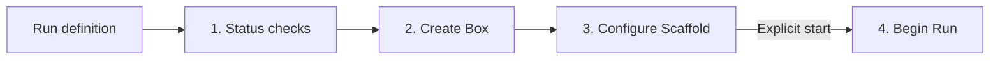

# Deployment contracts

The operator Run document owns its name, Scaffold, input path, model and required
effort. Optional provider, differing Box size and auxiliary resources are declared
once there. Installation-wide AWS scope belongs to the Invoker, outside this file.
The resolved `Run` graph is transient, not a second configuration file.

`Lifecycle` checks all drivers before mutation, reconciles dependencies in order,
and tears them down in reverse. Resources declare managed/external ownership and
delete/retain policy. External resources must be retained. Drivers observe live
state, recover named/tagged resources after interruption, and verify ownership
before mutation. Context tokens derive from account, region, deployment kind, Run
name and resource ID. No lifecycle method reads or writes local receipts.

Auxiliary assets and access grants can have different lifetimes: a grant depends
on the Box and asset, is deleted first, and may leave the asset retained. Future
drivers must protect successor ownership during handoffs. Controller resources
can use the same contract while retaining an independent lifecycle.
