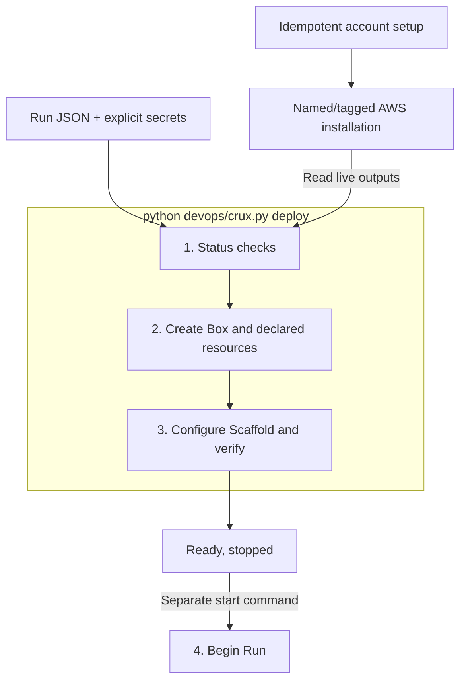
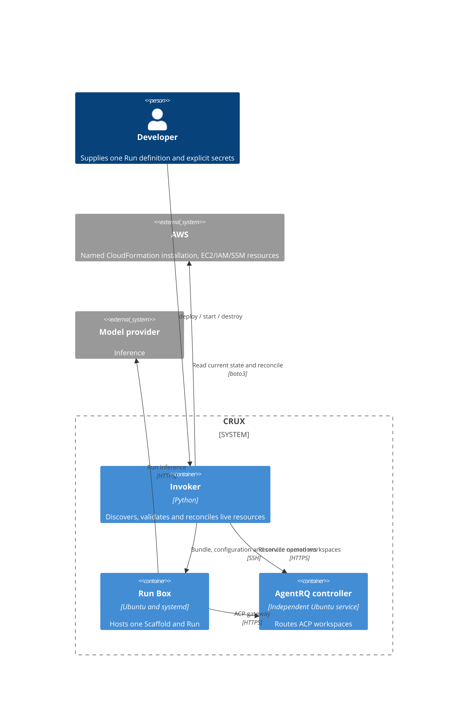

# DevOps design

Account setup creates the named `crux-account` CloudFormation stack, tagged
`CruxInstallation=crux-account`, and shared SSM configuration. Each deployment
reads that stack's current outputs and the selected explicit AWS profile. There
is no generated account file or local Run receipt. The operator owns one Run JSON;
model, required effort, provider and varying Box/resource requirements live there.

The installation supplies a public subnet, route, restricted SSH ingress, imported
public key and instance role. Network CIDRs and the Ubuntu family are fixed
implementation choices. Instance roles permit shared tracing configuration and
SSM host-key discovery; they do not grant research workloads account administration.
CloudFormation owns this shared infrastructure, outside Run teardown. Changes to
existing installation settings require reviewing a CloudFormation change set;
identical setup can be retried from any authorized laptop.

Resources declare dependencies, managed/external ownership and delete/retain
policy. Names and ownership tokens derive from account, region, Run name and
resource ID. Drivers observe current provider state, check ownership and recover
interrupted creation without a laptop record. Teardown stops the Run, then walks
dependencies in reverse; retained assets survive. PR #16 can add auxiliary-resource
and grant drivers using this contract. A grant can be deleted before its retained
asset, and ownership checks must protect successor handoffs.

The Invoker uses Python for AWS, HTTP, JSON/TOML and bundle assembly. Focused
Box-side shell programs install packages and operate systemd. SSM authenticates
SSH host-key discovery. Bundles and known-hosts files are temporary; secrets travel
separately. An installed marker on the Box describes its actual configuration and
is published only after configuration/probes succeed. Commands read it together
with systemd state; failed configuration cannot authorize start. An installed Run
is not reconfigured or restarted by retrying deploy.

For ACP, begin-Run starts the gateway and submits the installed `PROMPT.md` to its
workspace. The task's stable name is resolved through AgentRQ on each invocation,
including terminal tasks, so a lost response can be recovered without a local
task ID. Run status includes both gateway state and controller task status.

AgentRQ has its own resource graph and lifecycle. Its data volume and address are
retained during controller teardown, which requires confirming dependent Runs are
idle. Deploying again recreates compute and recovers the retained address and data.
Its launch token derives from the new IAM instance-profile identity, so retries
reuse the current Box without replaying the terminated Box's creation request.
A healthy controller publishes its endpoint at `/crux/controller/url`; ACP
Run deployment reads it at runtime. Run teardown removes only its own workspace,
never the controller. See the [resource contract](crux_devops/design.md).
