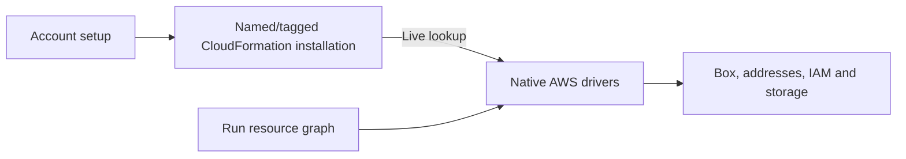

# AWS installation and resources

Account setup creates the `crux-account` CloudFormation stack, tagged
`CruxInstallation=crux-account`. It owns a VPC/public subnet, route, restricted SSH
ingress, imported public key and instance profile. Profile region and STS account
identity define the scope. No default-profile fallback is permitted.

Deployment discovers current stack outputs and the supported Ubuntu image through
SSM. The installation is independent from Runs, with termination protection and no
local account receipt. Credentials go to a shared SSM SecureString, never into
source or CloudFormation parameters. The Box role reads shared tracing settings
and supports SSM registration for authenticated host-key discovery.

Native boto3 drivers observe cloud state, validate ownership, reconcile using
stable names/tokens and delete in reverse dependency order. Address and volume
attachments are separate from assets so retention remains independent. The
[contract design](crux_devops/design.md) defines driver responsibilities. Drivers
never require a local receipt after interrupted creation or deletion.
