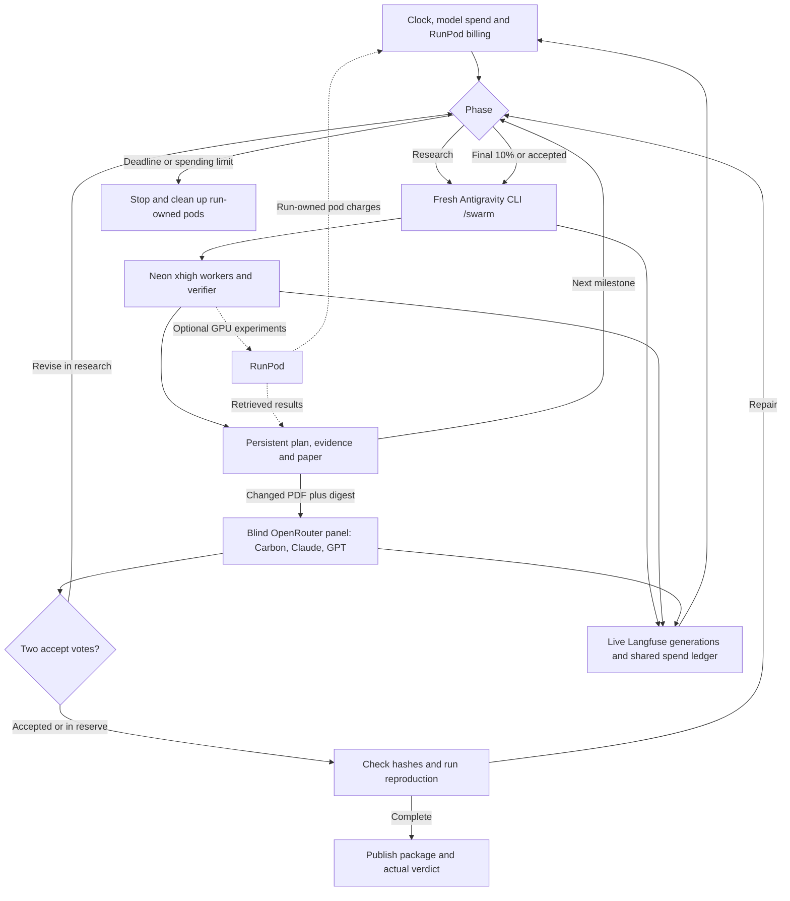

# TabPFN with Antigravity CLI

This experiment runs the TabPFN harmful-shift study on EC2 with Google's Antigravity CLI. Each Ralph iteration starts a fresh native `/swarm` using the dedicated AI Studio key and Neon at xhigh effort. The research brief, phase instructions and remaining budget accompany the new session. Workers share a persistent research workspace and can use RunPod for GPU experiments.

For prerequisites, deployment, monitoring and recovery, see the [operator guide](OPERATOR_GUIDE.md).

## Research and review

At a milestone, the coordinator updates the research plan and returns control to the loop. A changed paper goes to the historical Carbon, Claude and GPT reviewers through OpenRouter. Judges receive the anonymous PDF and rubric. Each review is bound to the PDF digest, and two accept votes pass. The next swarm can consult earlier rounds when choosing revisions.

Acceptance or entry into the final reserve moves the loop to packaging. The controller verifies the reviewed PDF, evidence hashes, HTML results and completion report, runs reproduction, and records the verdict with the finished package. A package completed in reserve can carry a rejection.

Langfuse groups each iteration’s coordinator, worker assignments, board messages, tool calls and generations in a live trace. Select the iteration or coordinator to see its rendered launch prompt and public response. Each delegate call and worker show the assignment and reported work as it arrives. Earlier board posts and tool results remain individually selectable. The exporter sends selected fields verbatim and retries delivery from a private outbox. Model usage is priced by Langfuse for Neon and by the provider for external review. Each iteration prompt and budget hook also report the latest RunPod bill, hourly rate and live pod count. RunPod posts hourly charges for compute and pod disk. Separately billed network volumes fall outside that total. The served Google Priority tier is unverified. [RunPod billing API](https://docs.runpod.io/api-reference-v2/billing/get-pod-billing-history) · [Google Priority inference](https://ai.google.dev/gemini-api/docs/priority-inference)

## Loop architecture

