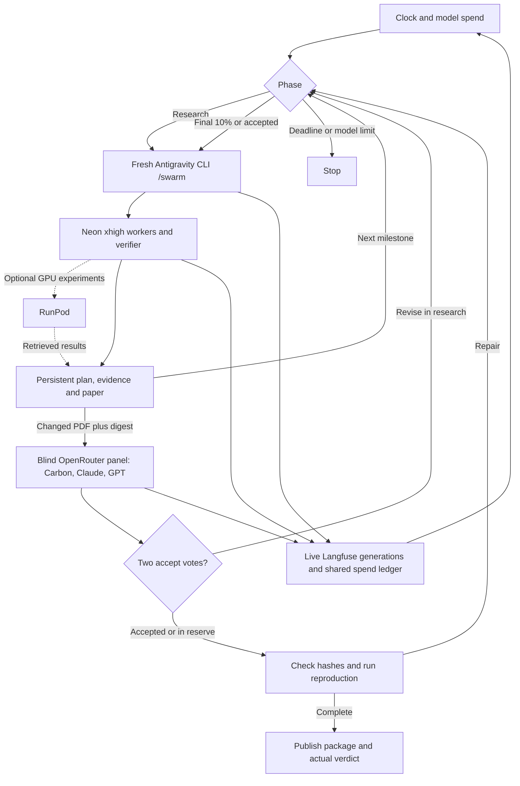

# TabPFN with Antigravity CLI

Run the original TabPFN harmful-shift study on EC2 with an outer loop and a native Antigravity swarm in each research and finalization iteration. Each iteration starts the pinned Antigravity CLI, selects its direct Gemini provider and runs Neon at xhigh effort. Research files and an iteration journal persist between sessions. The external reviewers use the historical OpenRouter models and PDF-only rubric.

## Deploy

Use a Linux/SSH-capable operator machine with Git, Python 3.11 or newer, boto3, a named AWS profile, an EC2 key pair and access to the selected subnet. The box runs Canonical Ubuntu 24.04 on x86-64. Run these commands from this directory in the Git checkout whose HEAD should be installed. The deployment bundles committed files.

```bash
python3 -m venv /tmp/tabpfn-deploy-venv
source /tmp/tabpfn-deploy-venv/bin/activate
pip install -r requirements.txt
export AWS_PROFILE=crux-2-acct-admin-access AWS_REGION=us-east-1 RUN_SLUG=tabpfn-neon
./deploy.sh --dry-run
```

Set `SUBNET_ID`, `SG_ID` and `KEY_NAME` for the dry run. For deployment set `SSH_KEY` and `VERIFIED_HOSTS` too. The script launches or finds the tagged instance, then configures it over verified SSH. If SSH host-key verification is pending after first launch, verify the host key, update known_hosts and rerun the script.

The default instance is an m7i.2xlarge with a 160 GiB encrypted gp3 root volume. Supply a subnet with outbound internet and an existing security group permitting SSH from the operator. The image, storage and instance type can be set on the launch command. A repeat launch reports the existing tagged instance. The retained root volume contains study data and credentials and continues accruing EBS charges after instance termination.

Verify the instance's SSH host key through your AWS operator channel and record it in known_hosts. Load the following values into the operator environment using the project's secret manager. The provisioner transmits them on SSH stdin and installs separate root-readable systemd environment files.

| Environment variable | Destination |
| --- | --- |
| AI_STUDIO_API_DEV_KEY | Antigravity CLI as GEMINI_API_KEY |
| RUNPOD_API_KEY (optional) | Run-owned GPU pods for research and reproduction |
| HF_TOKEN (optional) | Hugging Face checkpoint access |
| PRIOR_LABS_API_KEY (optional) | Prior Labs access, also exposed to the client as TABPFN_TOKEN |
| OPENROUTER_API_KEY | Independent paper reviewer |
| LANGFUSE_BASE_URL | Trace exporter, HTTPS |
| LANGFUSE_PUBLIC_KEY, LANGFUSE_SECRET_KEY | Trace exporter project |

```bash
./deploy.sh
```

Configure prints the absolute start command for the installed revision. Run it on the verified host when ready to start the study clock. The target resumes on reboot. The default clock is seven days with a $15,000 model budget. To run a short study, pass `--seconds SECONDS --usd USD` to `host.py start` on the **first** start. A restart retains the original limits and start time.

## Research and review

The controller gives every fresh session the study brief, phase instructions, and the current resource envelope. The question, standings, paper and research ledger live in `/home/tabpfn-research/research`. The CLI runs as the unprivileged research user. Autonomous shell commands are enabled inside this dedicated instance. Research requires network access to public literature, datasets and any licensed PFN weights selected for the study. Create a workspace virtual environment with python3 -m venv .venv for extra dependencies.

The CPU host can submit GPU jobs when the operator supplies a RunPod key. The separate $1,000 GPU allowance is tracked by the researchers in PLAN.md. Retrieve artifacts and terminate pods tagged for this run before shutdown.

The research model uses the dedicated AI Studio key only. The CLI's xhigh setting controls reasoning effort. Google separately controls per-request Priority service. The pinned CLI does not expose a verified Priority selector or return the served tier through the transcript. Configure the matching Neon model definition and its input, input_cached_tokens and output prices in the Langfuse project. The exporter sends exclusive token counts and reads back the server-calculated USD cost. Allow up to one minute for indexing. If costs remain unresolved, the controller suspends new model calls. Configure pricing before launch; historical generations may need reprocessing in Langfuse after a tariff correction. Reviews use the charges reported by OpenRouter. Both sources update the budget published to the swarm. [Google Priority inference](https://ai.google.dev/gemini-api/docs/priority-inference)

A review request identifies the exact compiled PDF by SHA-256. Only that PDF snapshot goes to the Carbon, Claude, and GPT judges. Each gets the original review rubric and independent PDF reading tools. Two accept votes pass. Feedback and the reviewed digest are published through `REVIEW_STATUS.json` and `reviews/` in the workspace. Completed judges and complete panel results are cached. A changed PDF requires a fresh verdict.

The first 90% of the envelope is for research. Acceptance or entry into the final reserve switches the loop to packaging. The controller checks the PDF, evidence hashes, reproduction, HTML results, README and completion report. A rejected final package can be preserved in the reserve with its actual verdict. `RUN_OUTCOME.json` records completed packaging. If the hard deadline arrives earlier, `/var/lib/tabpfn-study/stop.json` records exhaustion. Model charges are measured after calls and concurrent work can overshoot the threshold.

## Operate the box

```bash
systemctl status tabpfn-research tabpfn-budget tabpfn-review tabpfn-traces
sudo journalctl -u tabpfn-research -u tabpfn-review -u tabpfn-traces -f
cat /var/lib/tabpfn-study/public/BUDGET.json
sudo systemctl stop tabpfn-study.target
sudo systemctl start tabpfn-study.target
```

Use `systemctl disable --now tabpfn-study.target` to stop and keep the study stopped across reboot. `/var/lib/tabpfn-study/iterations.sqlite` identifies interrupted and returned turns. Raw CLI outputs and reproduction logs stay in the trusted state directory. Langfuse groups scrubbed conversation-step and review observations under the run slug. Its project key pair belongs to the exporter. The local SQLite outbox retains observations until delivery succeeds, including across an exporter restart.

If the reviewer process was killed mid-request, inspect its private status under `/var/lib/tabpfn-study/reviews`. To retry the outstanding submission, stop the reviewer service, invoke its installed `ExecStart` under the same service identity and environment with `--once --retry`, then restart it. Prior completed judges are reused. The operator owns archival and EC2 shutdown after the experiment.

## Loop architecture


