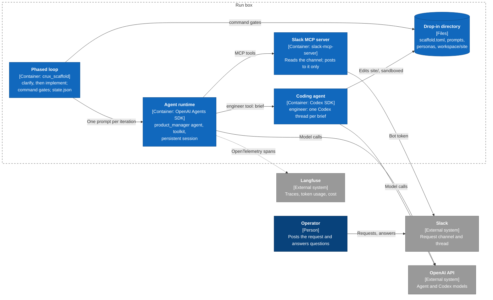
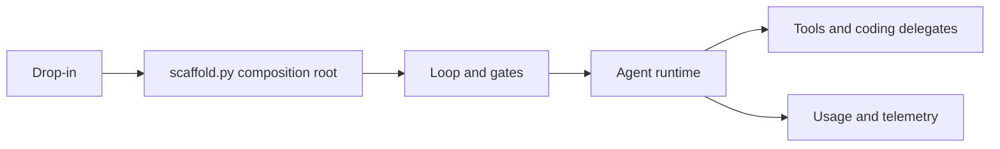

# SDK design

## Terminology

These terms follow the [repository terminology](../../README.md#concepts).

| Term | Meaning |
|---|---|
| **CRUX** | An experiment that evaluates AI agents on a real-world task. |
| **Scaffold** | The execution environment and operator-message interface. A Harness combines a Scaffold, Agents, context and configuration for a Run on a Box. |
| **Drop-in directory** | A CRUX's input to a scaffold: `scaffold.toml`, prompts, personas, standing context, extensions and the workspace. On a run box it is staged at `/srv/crux-run/run-harness`. |
| **Workspace** | The directory the agents work in, inside the drop-in directory. |
| **Agent runtime** | The agent SDK that runs the declared agents: OpenAI Agents SDK now, Claude Agent SDK later. |
| **Model provider** | The endpoint and API adapter the runtime uses to query models. Declared in `scaffold.toml`; the model and effort still come from the run environment. |
| **Agent**, **orchestrator** | An LLM agent declared with a persona, standing context and tools. The orchestrator is the agent that receives the loop's prompts. |
| **Coding agent** | A non-interactive coding-agent SDK session (Codex now, Claude Code later) that agents delegate implementation to. It runs the full coding harness as a subprocess, with its own tools, sandbox and context management, so it is far more capable at changing code than an agent. Declare an agent for planning, coordination and talking to people, and a coding agent for code changes. |
| **Delegate** | An agent or coding agent that another agent calls as a tool. It starts from a fresh context holding only the caller's brief. |
| **Persona**, **standing context** | Who an agent is (`personas/*.md`); durable operating files loaded once at assembly (`context`), separate from refreshed research state (`workspace_context`). |
| **Toolkit**, **tool** | The functions agents can call: built-ins plus a drop-in's extensions. |
| **Loop**, **phase**, **iteration** | The outer loop runs phases in order. Each phase repeats iterations, one prompt to the orchestrator each, until its gates pass. |
| **Gate** | A check the loop runs between iterations (the team's *gating criteria*): a deterministic verifier, or a judgment by an isolated model the agents cannot author. A failing gate produces the next prompt. |
| **Context strategy** | How an agent's conversation is stored, and what part of it reaches the model on each call. |
| **Budget** | Token, model-dollar and wall-clock limits checked between iterations. Resource providers can declare additional consumption limits. |
| **Resource provider** | A source of run-scoped measurements, with units, timestamps and optional limits, shown on orchestrator and delegate model calls. |
| **Steering channel** | How the operator and the agents reach each other. The demo uses Slack through MCP. |
| **Operator** | The human controlling the Run through the Invoker. |
| **Run box** | The remote execution environment; distinct from an AgentRQ workspace and the workspace directory. |

## Design

Each scaffold responsibility in the team's design has one interface. Built-in implementations register themselves under a type name; a drop-in adds its own through `extensions`. A drop-in can also declare an isolated judge gate.

| Responsibility | Interface (registry) | Built-in types |
|---|---|---|
| Agent orchestration, model configuration, optional background coding | `AgentRuntime` (`RUNTIMES`) | `openai-agents`; OpenAI and compatible Responses/Chat Completions providers |
| Agent loop: phases and gating criteria | `Loop` (`LOOPS`), `Gate` (`GATES`) | `phased`; `command`, `llm_judge` |
| Conversation retention and compaction | `ContextStrategy` (`CONTEXT_STRATEGIES`) | `persistent`, `trim_recent`, `compaction` |
| Toolkit | `Tool` (`TOOLS`) | `read_file`, `write_file`, `list_files`, `read_pdf`, `run_shell`, `command`, `rest`, `budget_status`, `escalate` |
| Coding subagents | `CodingAgent` (`CODING_AGENTS`) | `codex` |
| Communication (steering) | MCP servers in `[mcp_servers]`; `[runtime.steering]` | Slack/MCP inbox with durable delivery; `escalate` outbox |
| Observability | `Telemetry` | Langfuse, or off |
| Resource management | `Budget`, `ResourceProvider` (`RESOURCE_PROVIDERS`), `budget_status`, `AgentRuntime.delegation_slot` | token, model-dollar and time limits; `langfuse`, `aws-compute`, `runpod`; delegation concurrency and depth limits |

`scaffold.py` is the composition root: it is the only place components are built and wired together. `config.py`, `drop_in.py`, `loop.py`, `gates.py` and `tools.py` never import an agent SDK. The OpenAI Agents SDK is confined to `agent_runtimes/openai_agents_sdk.py` and `context_strategies.py`, and Codex to `coding_agents.py`.

The orchestrator receives a generated setup before its persona and static context. It describes the scaffold, phases and gates, available delegates/tools, steering, configured limits, context policy and restart behavior. These instructions are assembled once. Delegates get their own scoped setup and static files. Current phase, iteration, gate outcomes, research state and remaining resources belong in the dynamic user context. MCP launch arguments and environment values are excluded.

A drop-in can append guidance or disable the generated setup in `scaffold.toml`:

```toml
[preamble]
enabled = true  # false disables the generated setup
append = "Use the operator channel for questions about scope."
```

Both keys are optional. `append` is inline text placed after the generated setup and before the persona; it still applies when `enabled = false`. Disabling generation also removes the generated steering guidance. Personas and `context` files remain stable instructions; `workspace_context` is refreshed separately from conversation selection.

The web-cms-product-change demo in this design, as a C4 container view:



## Tracing

- **Context selection is visible.** Every SDK orchestrator/delegate selection emits a `context:select` span with strategy, agent, item target, before/after/dropped counts, retained input positions. It records metadata without conversation bodies, including no-op selections. Selection excludes legacy context snapshots and precedes task relocation, request-only cache markers and refreshed research/resource status. Static instructions remain outside conversation history. It makes no model call and adds no priced usage. Blind judges use their isolated input filter; native coding workers manage their own context. These events do not claim to trace those workers' internal trimming.

Langfuse v4 never updates an observation once it has stored it, so each observation is sent exactly once, when it ends. The scaffold keeps what it sends short-lived so that a long run stays visible while it progresses. These rules follow the AE-240 findings for the Codex boxes:

- **One trace per loop iteration.** Traces are named like `clarify #1` and grouped by the run's session (`RUN_SLUG`). A trace's root arrives when its iteration ends; its children arrive as they finish.
- **All SDK roles report usage incrementally.** PI, delegate and judge model calls export their own SDK generations; compaction exports one generation per handoff call. Coding workers export a `<worker>:usage` generation whenever their cumulative token usage advances, and book the same increment in the local ledger immediately. This is always enabled when tracing is configured, for every drop-in and both blocking and background workers. Langfuse ingestion and the resource provider's refresh interval still add latency; a model request in flight has no final usage yet.
- **Coding-agent turns stream.** A Codex brief retains one summary `generation` observation with its instructions, brief and final output, including any further turns it takes on the same thread after a transient provider failure. The summary explicitly carries zero input/output usage: only its incremental child generations are priced. Each retry is a `codex:turn_retry` span with the error kind and backoff; each finished item is sent as a child immediately. `codex:usage` spans preserve the native SDK's last-request and cumulative counters for inspection, including cache reads/writes and reasoning. Repeated or stale snapshots create no priced increment, and finalization, failure or cancellation never adds the cumulative total again. Usage increments are split into Langfuse's exclusive buckets (uncached input, cache reads, cache writes, output, reasoning), so each token is priced once, at its own rate. Cache and reasoning details survive in the persisted ledger; request counts track accepted increments rather than whole briefs.
- **Returned reasoning fields are preserved separately.** Responses calls request reasoning summaries with `summary = "auto"`; their SDK response spans retain returned summary and content fields, including providers that return content with an empty summary. Delegated Codex calls use `model_reasoning_summary = "auto"` and send each returned item as a `codex:reasoning` span with its ID, `summary` and `content` arrays. Content is not relabeled as a summary. Empty arrays remain empty; text availability and length do not determine billable reasoning-token usage. Opaque continuation state is not decoded into text.
- **Generations stay small.** Langfuse reads an Agents SDK generation's input and output from `input.value` and `output.value`, so the SDK's per-message attributes (`llm.input_messages.*`) are not recorded. They grow with the conversation, and past OpenTelemetry's 128-attribute limit they would evict the span's session, tags, model and usage.
- **A stopped scaffold flushes.** SIGTERM or SIGINT ends every open observation with level `WARNING` and a `stopped` status message before the process exits. A SIGKILL, such as from the OOM killer, still loses the open iteration's root and anything not yet flushed. Langfuse's flush interval is 5 seconds.
- **Model inputs are inspectable.** SDK generations use the existing OpenInference exporter: Input contains the ordered model messages, and Responses instructions are in Model Parameters (`instructions`) and the complete response output. Chat Completions includes instructions in its message list; Claude/OpenRouter uses the first developer message with a cache marker. Fresh state is labeled `<research_context>` and `<resource_status>`; a new task follows `# Current task` in the trailing user message. On tool continuations, the raw task remains in history and the tail refreshes state only. Earlier user messages are conversation history, not additional newly submitted tasks.
- **Compaction is inspectable too.** Only estimated token pressure triggers summarization; item count does not. `compaction:<agent>` generations record the ordinary inference input, returned handoff summary and usage. The PI uses the same provider/model/effort as its other calls, with no tools or recursive input filter. A separate checkpoint selects summary plus recent complete exchanges; SQLite retains the original conversation. Images have a configurable token allowance rather than being measured as base64 text. Compaction can reduce recent retention and validates the complete rendered request after refreshing context before saving a checkpoint; an irreducible oversized request stops before ordinary inference. Fixed instructions and fresh research/resource context remain independent of compaction. Coding generations record their developer instructions and actual prefixed brief; inner Codex requests remain owned by its harness.




Delegate communication state belongs to the runtime. Its internal `DelegateMailboxes` store gives each brief
a stable identity and separates PI control from delegate questions/progress. Durable messages and receipts
live outside the agent workspace in `delegates.sqlite`; they do not themselves schedule model calls. This
keeps transport and agent-SDK details out of routing, reply correlation and restart recovery. Runtime and
Codex adapters integrate this store separately.

With `runtime.interactive_delegates`, SDK delegates run asynchronously using a durable session per task ID.
The PI owns interruption, steering, resumption and progress requests. Delegate questions/progress are queued
for the PI's next normal model boundary or an explicitly requested inbox/result wait. They cannot interrupt
or initiate a PI turn. Uncollected work keeps the orchestrator iteration incomplete and postpones gates;
normal loop budgets still apply between iterations. Each named delegate has one outstanding conversation;
existing global delegation concurrency limits still apply.

Codex shares the same mailbox/lifecycle contract. Its adapter owns native thread resumption, `turn/steer`,
interrupt/drain/close and cumulative-usage checkpoints. A minimal stdio MCP endpoint exposes only questions
and progress reports, bound to the task when it starts. SDK-neutral task scheduling stays out of the Codex
adapter, and SDK-specific execution stays out of mailbox storage. There is no new broker service.
