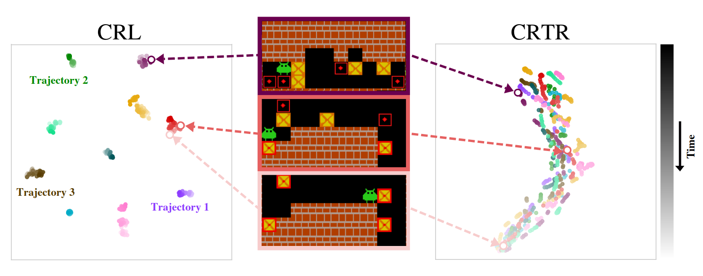

# Contrastive Representations for Temporal Reasoning

Official repository of [Contrastive Representations for Temporal Reasoning](TODO_arxiv_link) (CRTR).  

<p align="center">
  
</p>


## Installation
We recommend using Python v3.10. Set up the repository by running:
```bash
pip install -e .
```


## Datasets
### Example datasets
The example datasets for the Rubik's Cube and Sokoban are stored in `example_datasets/{rubik/sokoban}`. You can use them to verify that the code runs correctly. To replicate the results from the paper, please download the full datasets as described below.

### Downloading Full Datasets
#### Install huggingface-cli:
```pip install -U "huggingface_hub[cli]"```
#### Install git lfs (for Ubuntu):
```bash
sudo apt-get update
sudo apt-get install git-lfs
git lfs install
```


### Rubik's Cube
The dataset for the Rubik's Cube requires `12GB` of available storage. Download it by running:
```bash
huggingface-cli download oolongie/rubik_randomly_shuffled --repo-type dataset  --local-dir training_datasets/rubik
```
You can also generate the dataset by running:
```bash
python rubik_generate_script.py <number_of_shuffles (the paper uses 21)> <save_folder>
```

### Sokoban
The dataset for Sokoban requires `14GB` of available storage. Download it by running:
```bash
huggingface-cli download oolongie/sokoban-12-12-4-trajectories --repo-type dataset  --local-dir training_datasets/sokoban
```


### Digit Jumper
Subset (~14.4GB). Download:
```bash
huggingface-cli download oolongie/digit-jumper-trajectories --repo-type dataset --local-dir training_datasets/digit_jumper
```
Files: `dataset_part_{i}.pkl` + `dataset_part_{i}_lens.pkl` (variable length).

### Lights Out
Subset (~14.5GB, 7×7). Download:
```bash
huggingface-cli download oolongie/lights-out-trajectories --repo-type dataset --local-dir training_datasets/lights_out
```
Files: `lights_out_trajectories_{i}.pkl` (fixed length).

### N-Puzzle
5×5 trajectories (~3.1GB). Download:
```bash
huggingface-cli download oolongie/npuzzle-trajectories --repo-type dataset --local-dir training_datasets/npuzzle
```
Files: `npuzzle_trajectories_{i}.pkl`, shape `(10000, 205, 25)`.

For the ICLR 15-puzzle (4×4) setting, use a local 4×4 dataset and override:
`NPuzzle.n=4`, `LNDenseNet.input_size=16`, and the dataset path.

### Colorful Maze
Main set (~955MB). Download:
```bash
huggingface-cli download oolongie/colorful-maze-trajectories --repo-type dataset --local-dir training_datasets/colorful_maze
```
Files: `dataset_part_0.pkl` + `dataset_part_0_lens.pkl`.


### Eval Boards
Boards that are used for Sokoban evaluation are stored in `example_datasets/sokoban_eval_boards/eval_boards.pkl`.


## Training
To run the training of our method, use the following command:

### Rubik's Cube
For the example dataset:
```bash
python runner.py --config_file configs/train/crtr/rubik.gin
```
For the real dataset:
```bash
python runner.py --config_file configs/train/crtr/rubik.gin --gin_bindings "ContrastiveDataset.path=training_datasets/rubik"
```

### Sokoban
For the example dataset:
```bash
python runner.py --config_file configs/train/crtr/sokoban.gin
```
For the real dataset:
```bash
python runner.py --config_file configs/train/crtr/sokoban.gin --gin_bindings "ContrastiveDataset.path=training_datasets/sokoban/train" "TrainJob.test_path=training_datasets/sokoban/test"
```

### Digit Jumper / Lights Out / N-Puzzle / Colorful Maze
Train configs include **no-search** eval (`SolveJob.n_actions=1`) for through-training curves:
```bash
python runner.py --config_file configs/train/crtr/digit_jumper.gin
python runner.py --config_file configs/train/crtr/lights_out.gin
python runner.py --config_file configs/train/crtr/npuzzle.gin
python runner.py --config_file configs/train/crtr/colorful_maze.gin
```
Paper no-search budgets logged as `*_shuffles_argmax/solved_rate_{B}_nodes` with
`B ∈ {50 (Digit Jumper), 75 (Lights Out), 500 (N-Puzzle)}`.

## Evaluation
Pretrained checkpoints are provided in the folder `example_checkpoints`.
Each domain has both **search** and **no-search** (`n_actions=1` / argmax) solve configs under `configs/solve/{search,no-search}/contrastive/`.

Search (`n_actions`: Sokoban/Rubik 12, Lights Out 10, Digit Jumper/N-Puzzle/Colorful Maze 4):
```bash
python runner.py --config_file configs/solve/search/contrastive/sokoban.gin
python runner.py --config_file configs/solve/search/contrastive/rubik.gin
python runner.py --config_file configs/solve/search/contrastive/digit_jumper.gin
python runner.py --config_file configs/solve/search/contrastive/lights_out.gin
python runner.py --config_file configs/solve/search/contrastive/npuzzle.gin
python runner.py --config_file configs/solve/search/contrastive/colorful_maze.gin
```

No-search (argmax):
```bash
python runner.py --config_file configs/solve/no-search/contrastive/sokoban.gin
python runner.py --config_file configs/solve/no-search/contrastive/rubik.gin
python runner.py --config_file configs/solve/no-search/contrastive/digit_jumper.gin
python runner.py --config_file configs/solve/no-search/contrastive/lights_out.gin
python runner.py --config_file configs/solve/no-search/contrastive/npuzzle.gin
python runner.py --config_file configs/solve/no-search/contrastive/colorful_maze.gin
```

## Logging 
By default, experiment artifacts and results are stored in directory `result_<timestamp>` 
