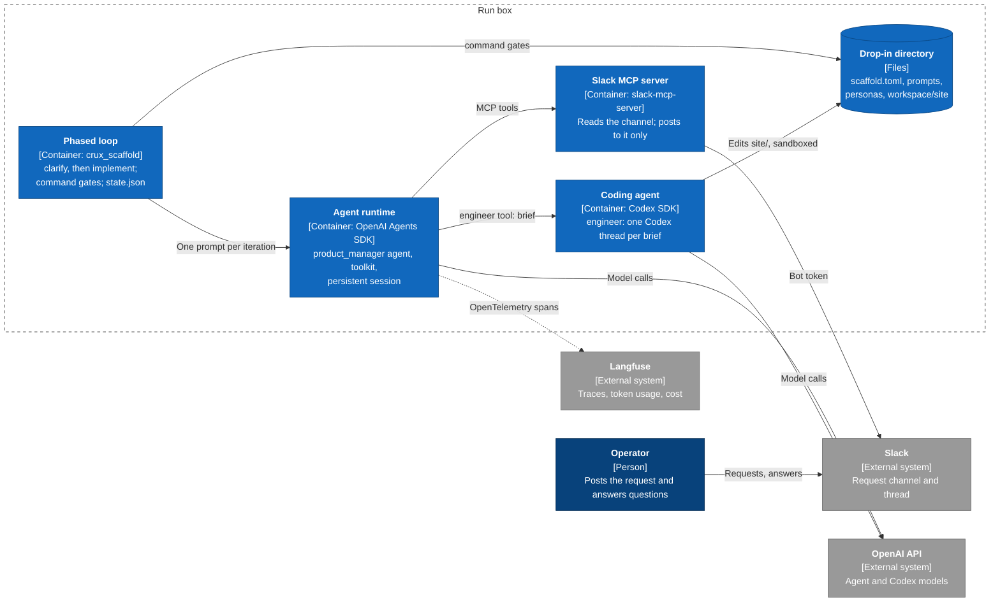

# `sdk-scaffold/` — a CRUX scaffold built on agent SDKs

`crux_scaffold` runs a CRUX from a **drop-in directory**. Everything about the run is declared in the drop-in's `scaffold.toml`: which agents exist and what each may call, how the outer loop decides a phase is done, how context is managed, and its budgets and resource providers. The scaffold assembles that declaration from registered components. It runs agents on the OpenAI Agents SDK and delegates coding to Codex ([AE-230](https://linear.app/agent-evals/issue/AE-230/prototype-custom-scaffold-using-agent-sdks)).

## Terminology

These terms follow `ciab-design-docs` (*CRUX Scaffold Philosophy* and *CRUX Scaffold Design*).

| Term | Meaning |
|---|---|
| **CRUX** | An experiment that evaluates AI agents on a real-world task. |
| **Scaffold** | The infrastructure around the LLMs: tools, prompts, loops. Claude Code, Codex, OpenClaw and this package are all scaffolds. The team docs also say *harness*; this package avoids that word. |
| **Drop-in directory** | A CRUX's input to a scaffold: `scaffold.toml`, prompts, personas, standing context, extensions and the workspace. On a run box it is staged at `/srv/crux-run/run-harness`. |
| **Workspace** | The directory the agents work in, inside the drop-in directory. |
| **Agent runtime** | The agent SDK that runs the declared agents: OpenAI Agents SDK now, Claude Agent SDK later. |
| **Agent**, **orchestrator** | An LLM agent declared with a persona, standing context and tools. The orchestrator is the agent that receives the loop's prompts. |
| **Coding agent** | A non-interactive coding-agent SDK session (Codex now, Claude Code later) that agents delegate implementation to. It runs the full coding harness as a subprocess, with its own tools, sandbox and context management, so it is far more capable at changing code than an agent. Declare an agent for planning, coordination and talking to people, and a coding agent for code changes. |
| **Delegate** | An agent or coding agent that another agent calls as a tool. It starts from a fresh context holding only the caller's brief. |
| **Persona**, **standing context** | Who an agent is (`personas/*.md`); the operator-declared files it needs, injected at boundaries chosen by its context strategy. |
| **Toolkit**, **tool** | The functions agents can call: built-ins plus a drop-in's extensions. |
| **Loop**, **phase**, **iteration** | The outer loop runs phases in order. Each phase repeats iterations, one prompt to the orchestrator each, until its gates pass. |
| **Gate** | A check the loop runs between iterations (the team's *gating criteria*): a deterministic verifier, or a judgment by an isolated model the agents cannot author. A failing gate produces the next prompt. |
| **Context strategy** | How an agent's conversation is stored, and what part of it reaches the model on each call. |
| **Budget** | Token, model-dollar and wall-clock limits checked between iterations. Resource providers can declare additional consumption limits. |
| **Resource provider** | A source of run-scoped measurements, with units, timestamps and optional limits, shown on orchestrator and delegate model calls. |
| **Steering channel** | How the operator and the agents reach each other. The demo uses Slack through MCP. |
| **Operator** | The human running the CRUX. |
| **Run box** | The EC2 instance a run executes on; `src/ec2-workspaces/` calls it a *workspace*. |

## Design

Each scaffold responsibility in the team's design has one interface. Built-in implementations register themselves under a type name; a drop-in adds its own through `extensions`. A drop-in can also declare an isolated judge gate.

| Responsibility | Interface (registry) | Built-in types |
|---|---|---|
| Agent orchestration, model configuration | `AgentRuntime` (`RUNTIMES`) | `openai-agents` |
| Agent loop: phases and gating criteria | `Loop` (`LOOPS`), `Gate` (`GATES`) | `phased`; `command`, `llm_judge` |
| Context management and standing-context injection | `ContextStrategy` (`CONTEXT_STRATEGIES`) | `persistent`, `trim_recent`, `openai_compaction` |
| Toolkit | `Tool` (`TOOLS`) | `read_file`, `write_file`, `list_files`, `read_pdf`, `command`, `rest`, `budget_status` |
| Coding subagents | `CodingAgent` (`CODING_AGENTS`) | `codex` |
| Communication (steering) | MCP servers in `[mcp_servers]` | any stdio MCP server; the demo uses Slack |
| Observability | `Telemetry` | Langfuse, or off |
| Resource management | `Budget`, `ResourceProvider` (`RESOURCE_PROVIDERS`), `budget_status` | token, model-dollar and time limits; `langfuse`, `aws-compute`, `runpod` |

`scaffold.py` is the composition root: it is the only place components are built and wired together. `config.py`, `drop_in.py`, `loop.py`, `gates.py` and `tools.py` never import an agent SDK. The OpenAI Agents SDK is confined to `agent_runtimes/openai_agents.py` and `context_strategies.py`, and Codex to `coding_agents.py`.

The web-cms-product-change demo in this design, as a C4 container view:



## A drop-in directory

```
scaffold.toml            the declaration (see examples/web-cms-product-change/scaffold.toml)
PROMPT.md                first phase's prompt, sent verbatim
prompts/*.md             later phase prompts, each phase's continue prompt, and judge rubrics
personas/*.md            one per agent
scaffold_extensions.py   optional: the drop-in's own components
workspace/               where agents work; AGENTS.md and other standing context live here
OPERATOR_GUIDE.md        how to resolve placeholders and launch; operator notes live only here
```

The run stops before any model call if an operator-facing file or standing-context file still contains a `{{KEY}}` or `{{KEY|default}}` placeholder. The error lists each one as `file:line`.

Each agent and coding agent chooses its own standing context in `scaffold.toml`:

```toml
[agents.product_manager]
persona = "personas/product_manager.md"
context = ["workspace/AGENTS.md"]        # static files relative to the drop-in (run-harness on a box)
workspace_context = ["REQUEST.md", "LOG.md"]  # dynamic paths relative to the workspace
context_max_chars = 32000                # total snapshot limit, including truncation notice
```

Static files must exist at launch. Dynamic paths may be created during the run; absent files appear as `[Not created yet.]`. Paths stay within their declared root, including symlinks. Files are read when the strategy injects a snapshot. `persistent` injects once on the first turn and keeps that snapshot across restarts. `openai_compaction` also injects on the first turn after compaction. `trim_recent` refreshes when the previous snapshot falls outside its recent history and retains it throughout tool calls. Personas remain model instructions on every call.

Snapshots are developer messages saved with the conversation. They are capped at `context_max_chars` (default 32,000; minimum 200), with a notice directing the agent to read the full files when truncated. Each fresh agent delegate and each coding brief reads its own current snapshot. For coding agents it becomes developer instructions in their fresh SDK session; their coding harness manages subsequent context. A persistent conversation does not refresh files on every turn, so agents still read files they need updated between snapshots.

## Extending

Implement the interface, register the class, and list the module in `extensions`. The class's `Options` model is its declarative configuration. For example, the demo's tool:

```python
@TOOLS.register
class SitePreview(Tool):
    type_name = "site_preview"
    description = "Build the site and return one page's HTML."
    Arguments = PreviewArguments

    async def invoke(self, ctx: RunContext, args: PreviewArguments) -> str: ...
```

```toml
extensions = ["scaffold_extensions.py"]

[agents.product_manager]
tools = ["read_file", "site_preview"]
```

Gates, context strategies, coding agents, loops and runtimes extend the same way. [docs/extending.md](docs/extending.md) describes each extension point's contract, and when to extend one rather than add a new abstraction.

## Adapting the demo

A CRUX with different needs changes declarations, not code. The same drop-in could, for example:

- **Judge the outcome, not just the tests.** Add an isolated `llm_judge` gate to the `implement` phase. The judge is an agent with no access to the orchestrator's conversation. It starts from its rubric, the orchestrator's final output and the workspace files listed in `inspect`, then verifies the work with its `tools`: `read_file` and `list_files` by default, plus any declared tool, such as a `command` tool that runs the tests. Running out of `max_turns` fails the gate. Have the rubric ask the judge to cite what it checked. It can write the next prompt itself.
  ```toml
  [[loop.phases]]
  name = "implement"
  gates = ["site_tests_pass", "request_met"]

  [gates.request_met]
  type = "llm_judge"
  rubric = "prompts/judge_request.md"
  inspect = ["REQUEST.md"]
  tools = ["read_file", "list_files", "site_tests"]
  max_turns = 20
  ```
- **Review a submission blind.** Opt into evidence isolation with `blind = true`. Map neutral filenames to the
  exact submission files in the workspace. Each review snapshots those files afresh and exposes only the aliases;
  it receives the fixed rubric and artifact list, with no orchestrator output, phase, iteration or prior reviews.
  The reviewer can read UTF-8 evidence and extract/render PDF pages, including figures, through restricted tools.
  Its verdict, feedback, next prompt, telemetry and usage accounting work as in ordinary judging.
  ```toml
  [gates.paper_review]
  type = "llm_judge"
  rubric = "prompts/research_review.md"
  blind = true
  artifacts = { "submission.pdf" = "results/paper.pdf", "data.csv" = "results/data.csv" }
  tools = ["read_file", "list_files", "read_pdf"]
  max_turns = 20
  ```
  Do not set `inspect` in blind mode. Only the built-in `read_file`, `list_files` and `read_pdf` implementations
  are permitted: shell commands, writes, custom tools and access to other workspace files are rejected. Missing,
  symlinked, non-regular or over-32-MiB artifacts fail the gate before calling a reviewer. Aliases are simple
  filenames, without directories. The drop-in owns anonymization of the rubric, aliases and artifact contents:
  leave out author identities, plans/logs, prior reviews, expected scores and revision cues. PDF tools expose page
  text and pixels, without document properties, attachments, source paths or filesystem metadata. No artifact code
  is executed. Run a small live review with your configured runtime and submission formats before a research run;
  automated tests use scripted models and make no network calls.

## Commands

```bash
python -m crux_scaffold check --drop-in DIR --state-dir STATE   # validate and print the assembly; no model calls
python -m crux_scaffold run --drop-in DIR --state-dir STATE     # run the loop; a rerun with STATE resumes it
python -m crux_scaffold probe [--coding-agent codex]   # one traced model call (plus one Codex turn)
```

`probe --coding-agent codex` retries temporary-directory cleanup for up to 3.1 seconds when Codex's background plugin checkout is still writing files after its session closes. Other cleanup errors, or a directory that remains busy, still fail the probe.

`check` and `probe` are the first two of the team's testing protocols: nothing in the environment is broken, and the agent can do anything at all. Exit codes:

- 0: the loop completed.
- 1: a probe failed.
- 2: a configuration error.
- 3: the loop stopped early because its iterations or budget ran out.
- 128 + the signal number: the run was stopped by SIGTERM or SIGINT. The unfinished iteration reruns on restart.

## Budgets and resource context

Every orchestrator and delegated SDK model call receives a fresh resource-status
block after context selection. It includes tokens, elapsed time, model spend,
remaining configured budgets, and each declared external resource. The block is
ephemeral: it does not accumulate in the conversation history. Codex usage is
included when its turn finishes; its internal model calls are owned by Codex.
The `budget_status` tool forces an on-demand refresh through the same providers.

```toml
[budget]
max_total_tokens = 1000000
max_cost_usd = 100.0
max_wall_seconds = 86400
model_resource = "models"

[resources.models]
type = "langfuse"
```

Deploy the [Langfuse cost tracker](../../lambda/langfuse_cost_tracker/README.md)
and supply `COST_TRACKER_URL`, `COST_TRACKER_TOKEN`, and a unique `RUN_SLUG`.
The model-dollar budget requires a declared `model_resource`; the `langfuse`
provider reads its cost and token totals from AE-225's API. The token budget
uses the larger of the local and reported totals, never their sum. Other resource
costs are displayed independently and can have their own limits.

Providers are registered components under `[resources.<name>]`. Each has
`refresh_seconds` (default 0), `timeout_seconds` (default 10), and optional
`limits = { metric_name = value }`. Limits apply to consumption measurements in
the provider's stated units. A future credits or API-spend source can implement
`ResourceProvider` in a drop-in extension; see [the contract](docs/extending.md#resource-providers-resourceprovider).

The phased loop checks token, time, model-cost and resource limits between
iterations, using available measurements. An in-flight turn can overshoot a
limit. Providers refresh independently and may use cached data; the status
shows timestamps, cache state, missing measurements and retained stale values.
An outage does not silently become zero usage or halt the run on its own.
Reported spend can lag or omit unexported/unpriced generations, so these are
pacing controls rather than guarantees against an invoice exceeding a limit.

The first run timestamp and local tokens are saved in `state.json`, including on
an orderly interruption. Restarts keep elapsed time, including downtime. Use a
new state directory for a new run. When resuming state created before timestamps
were recorded, the first upgraded launch establishes the start; migrate
`usage.started_at` to the actual UTC start if earlier spend/time should be included.
Without configured providers, local tokens and elapsed time still appear and
external usage is explicitly unavailable. `check` validates configuration without
querying providers or starting the clock.

### AWS compute and RunPod

Add either or both providers to the same declaration:

```toml
[resources.aws]
type = "aws-compute"
region = "us-east-1"
tag_key = "Name"
tag_value_env = "RUN_SLUG"
profile_env = "AWS_PROFILE"
refresh_seconds = 3600
limits = { cost_usd = 200.0 }

[resources.gpu]
type = "runpod"
refresh_seconds = 60
limits = { cost_usd = 200.0 }
```

`aws-compute` requires the AWS CLI and an explicit profile from `AWS_PROFILE`
(or `profile_env`). Every command passes that profile; a failed identity check
stops that refresh and reports the SSO reauthentication command. The profile
needs `sts:GetCallerIdentity`, `ce:GetCostAndUsage`, and `ec2:DescribeInstances`.
It reads regional EC2 compute spending scoped to that account and the exact run
tag, plus running instance count. Other AWS services, storage and public IP
charges are outside this collector's scope. Usage quantities retain their
individual AWS usage types and units.

The existing provisioner tags instances `Name=RUN_SLUG`. Activate the selected
tag for cost allocation before the run, and use a value dedicated to this run.
AWS billing is daily, can lag more than a day, and Cost Explorer charges per
request; the default refresh is hourly. Empty billing is shown as unknown,
even when a live instance count is available. See [AWS Cost Explorer](https://docs.aws.amazon.com/cost-management/latest/userguide/ce-what-is.html).

`runpod` requires `RUNPOD_API_KEY` (or `api_key_env`) and a unique `RUN_SLUG`
(or `run_slug_env`). No pod IDs are needed before launch. When creating a pod,
set its environment variable `CRUX_RUN_SLUG` to the run slug. The status block
supplies the exact value to use. The collector pages through the account's pods
on each refresh and adopts only exact marker matches, including cluster members;
names, creation time and other runs' pods do not establish ownership.

Discovered IDs are saved atomically under `state_dir/resources/runpod-*.json`
before billing is queried. They remain tracked after termination and process
restart, so delayed charges are still counted when the pod disappears from the
live list. Preserve the whole state directory when resuming. Inventory is bound
to the provider name, run slug and persisted start time; corruption or a scope
mismatch fails the refresh instead of forgetting prior spending. Never reuse a
pod or run slug across runs, or change a tracked pod's ownership marker.

Discovery polls at `refresh_seconds`. After creating a short-lived pod, call
`budget_status` before terminating it to force discovery; a pod created and
terminated entirely between refreshes cannot be attributed from billing alone.
Pods already terminated before first discovery are outside coverage. With no
discovered pods a successful complete list reports zero; once pods are known,
missing billing is unknown, not zero. Discovery/billing failures retain the
last complete snapshot as stale.

The API v2 collector reports total/GPU/CPU/disk spend, running pods/GPUs, and
the current hourly rate. Billing uses hour-aligned windows; AWS uses day-aligned
windows, so both can include time before the scaffold started. Neither
extrapolates an invoice from a current rate. Account-wide balance changes are
not used to attribute shared-account spend to a run.
RunPod's billing API does not report GPU-hours; the provider labels that
limitation. Serverless and separate network-volume spending are outside this
collector. See [RunPod billing](https://docs.runpod.io/api-reference-v2/billing/get-pod-billing-history)
and [pod discovery](https://docs.runpod.io/api-reference-v2/pods/list-pods).

Each provider has a 30-second overall read deadline. A failed or incomplete
refresh retains the previous complete snapshot as stale, including known
costs and their timestamp. Keep credentials outside the repository and pass
only the required credentials/profile into the scaffold process or container.

## Tracing

Langfuse v4 never updates an observation once it has stored it, so each observation is sent exactly once, when it ends. The scaffold keeps what it sends short-lived so that a long run stays visible while it progresses. These rules follow the AE-240 findings for the Codex boxes:

- **One trace per loop iteration.** Traces are named like `clarify #1` and grouped by the run's session (`RUN_SLUG`). A trace's root arrives when its iteration ends; its children arrive as they finish.
- **Coding-agent turns stream.** A Codex turn is one `generation` observation. Each Codex item, such as a command, file change or message, is sent as a child the moment it completes. The generation itself arrives at the end of the turn with the output and token usage. Usage is split into Langfuse's exclusive buckets (uncached input, cache reads, cache writes, output, reasoning), so each token is priced once, at its own rate.
- **Reasoning summaries are requested and traced.** Native OpenAI Agents calls set the Responses API reasoning-summary setting to `auto`, which selects the most detailed summarizer available for the model; their SDK response spans carry returned summary text. Delegated Codex calls use `model_reasoning_summary = "auto"` for the same selection and send each returned reasoning item as a `codex:reasoning` span. These are model-generated summaries, not private chain-of-thought; a model or provider may omit them.
- **Generations stay small.** Langfuse reads an Agents SDK generation's input and output from `input.value` and `output.value`, so the SDK's per-message attributes (`llm.input_messages.*`) are not recorded. They grow with the conversation, and past OpenTelemetry's 128-attribute limit they would evict the span's session, tags, model and usage.
- **A stopped scaffold flushes.** SIGTERM or SIGINT ends every open observation with level `WARNING` and a `stopped` status message before the process exits. A SIGKILL, such as from the OOM killer, still loses the open iteration's root and anything not yet flushed. Langfuse's flush interval is 5 seconds.
- **Standing-context snapshots are visible.** `standing_context:<agent>` spans report the declared paths, injected character count and whether truncation occurred. `compaction:<agent>` generations record compaction usage in telemetry and the budget.

## Environment

| Variable | Use |
|---|---|
| `OPENAI_API_KEY` | Agent, judge and Codex model calls |
| `CRUX_MODEL`, `CRUX_REASONING_EFFORT` | The model and effort for every agent and coding agent. They are the only place these are set; a drop-in cannot override them. A run without `CRUX_MODEL` stops with a configuration error. |
| `LANGFUSE_PUBLIC_KEY`, `LANGFUSE_SECRET_KEY`, `LANGFUSE_BASE_URL` | Tracing. When unset, tracing is off; `probe` requires it. |
| `RUN_SLUG`, `CRUX_WORKSPACE_ID` | The trace environment (the slug, lowercased), session, tags and metadata. These match the Codex and Claude boxes. |
| `COST_TRACKER_URL`, `COST_TRACKER_TOKEN` | HTTPS endpoint and bearer credential for a declared `langfuse` resource provider; `RUN_SLUG` is also required. |
| `AWS_PROFILE` | Required explicit profile for `aws-compute`; the profile and AWS CLI must be available in the scaffold's environment. |
| `RUNPOD_API_KEY` | List access to pods (including their ownership environment marker) and read access to pod billing for `runpod`. |
| Variables that `[mcp_servers]` reference | For example `SLACK_BOT_TOKEN`. An MCP server receives only its declared `env` and a minimal `PATH`/`HOME` environment. |

## Run the demo in Docker

`docker/demo.sh` builds an image holding the scaffold, the demo drop-in and the Slack MCP server, then runs it. The container stages the drop-in once in the volume `crux-sdk-scaffold-demo` at `/work/web-cms-product-change`, so a rerun resumes the run there.

1. **Slack.** Create the app from [`examples/web-cms-product-change/slack-app-manifest.yaml`](examples/web-cms-product-change/slack-app-manifest.yaml), then install it, invite the bot to a channel and copy the channel ID. See the demo's [OPERATOR_GUIDE.md](examples/web-cms-product-change/OPERATOR_GUIDE.md), section 1.
2. **Secrets.** Export them in the shell that runs `demo.sh`. `read -rs` keeps them off the screen and out of shell history:

   ```bash
   for name in OPENAI_API_KEY SLACK_BOT_TOKEN LANGFUSE_PUBLIC_KEY LANGFUSE_SECRET_KEY; do
     printf '%s: ' "$name"; read -rs "$name"; export "$name"; echo
   done
   export LANGFUSE_BASE_URL=https://us.cloud.langfuse.com CRUX_MODEL=<model> CRUX_REASONING_EFFORT=medium
   export RUN_SLUG=local-<you> SLACK_CHANNEL_ID=C…
   ```

   The Langfuse keys are the CRUX project's, the same ones stored in SSM `/crux/system/env`. `demo.sh` passes each variable to the container by name (`--env NAME`), so no value appears on a command line.
3. **Run.**

   ```bash
   cd src/sdk-scaffold
   docker/demo.sh probe   # one traced model call and one Codex turn
   docker/demo.sh check   # stage the drop-in and print its assembly; no model calls
   docker/demo.sh run
   ```

   Before `run`, post the request in the channel as yourself, as a top-level message: *"Can events show where they're happening?"* Then answer the agent's question in the thread. The demo's OPERATOR_GUIDE.md, sections 3 and 4, describes the run and what success looks like.
4. **Inspect, stop, reset.**
   - `docker/demo.sh bash` opens a shell in the volume. `REQUEST.md`, `LOG.md` and `site/` are in `/work/web-cms-product-change/workspace`, and the loop state is in `/work/web-cms-product-change/.state`.
   - Ctrl-C or `docker stop` ends the run cleanly (exit 130 or 143). `docker/demo.sh run` resumes it.
   - `docker/demo.sh reset` deletes the volume so the next run starts fresh.

Inside the container, Codex runs with `sandbox = "full-access"` because its Linux sandbox (bubblewrap) cannot create namespaces in an unprivileged container. The container is the boundary instead: it runs as a non-root user, and the volume at `/work` is its only persistent storage. A run box keeps `workspace-write`.

## On a run box

Set `AGENT_PLATFORM=openai-agents` and `DROP_IN_PATH=<drop-in directory>` in the workspace base config; see [`../ec2-workspaces/README.md`](../ec2-workspaces/README.md). Provisioning does four things, and creates no AgentRQ workspace:

1. It stages this directory, root-owned, at `/opt/crux-sdk-scaffold`, and the drop-in at `/srv/crux-run/run-harness`.
2. It writes the environment above to `/etc/crux-run.env`.
3. It installs system Bubblewrap and Ubuntu's AppArmor profile for it, then checks sandboxed shell execution and file write/readback before running `probe --coding-agent codex`. `workspace-write` remains the default; global user-namespace restrictions are unchanged.
4. It installs `crux-sdk-run.service`, but does not start it.

## Development

```bash
cd src/sdk-scaffold
uv venv .venv --python 3.12
uv pip install --python .venv/bin/python -r requirements.txt -r ../../requirements-dev.txt
.venv/bin/ruff check . && .venv/bin/python -m pytest -q tests
```

Contribution guidelines are in [AGENTS.md](AGENTS.md). Tests never call a model or the network. They use scripted models, a scripted coding agent, a fake runtime, a fake stdio Slack MCP server and an in-memory span exporter.
