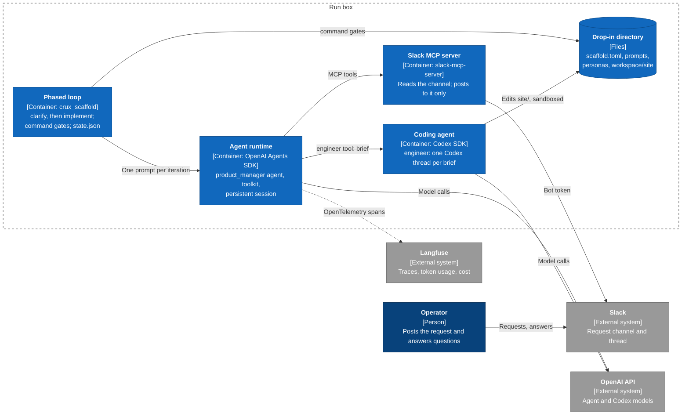

# `sdk-scaffold/` — a CRUX scaffold built on agent SDKs

`crux_scaffold` runs a CRUX from a **drop-in directory**. Everything about the run is declared in the drop-in's `scaffold.toml`: which agents exist and what each may call, how the outer loop decides a phase is done, how context is managed, and its budgets and resource providers. The scaffold assembles that declaration from registered components. It runs agents on the OpenAI Agents SDK with OpenAI or compatible model providers, and supports delegated coding through Codex ([AE-230](https://linear.app/agent-evals/issue/AE-230/prototype-custom-scaffold-using-agent-sdks), [AE-268](https://linear.app/agent-evals/issue/AE-268)).

## Terminology

These terms follow `ciab-design-docs` (*CRUX Scaffold Philosophy* and *CRUX Scaffold Design*).

| Term | Meaning |
|---|---|
| **CRUX** | An experiment that evaluates AI agents on a real-world task. |
| **Scaffold** | The infrastructure around the LLMs: tools, prompts, loops. Claude Code, Codex, OpenClaw and this package are all scaffolds. The team docs also say *harness*; this package avoids that word. |
| **Drop-in directory** | A CRUX's input to a scaffold: `scaffold.toml`, prompts, personas, standing context, extensions and the workspace. On a run box it is staged at `/srv/crux-run/run-harness`. |
| **Workspace** | The directory the agents work in, inside the drop-in directory. |
| **Agent runtime** | The OpenAI Agents SDK integration that runs the declared agents. |
| **Model provider** | The endpoint and API adapter the runtime uses to query models. Declared in `scaffold.toml`; the model and effort still come from the run environment. |
| **Agent**, **orchestrator** | An LLM agent declared with a persona, standing context and tools. The orchestrator is the agent that receives the loop's prompts. |
| **Coding agent** | A non-interactive coding-agent SDK session (Codex now, Claude Code later) that agents delegate implementation to. It runs the full coding harness as a subprocess, with its own tools, sandbox and context management, so it is far more capable at changing code than an agent. Declare an agent for planning, coordination and talking to people, and a coding agent for code changes. |
| **Delegate** | An agent or coding agent that another agent calls as a tool. It starts from a fresh context holding only the caller's brief. |
| **Persona**, **standing context** | Who an agent is (`personas/*.md`); the operator-declared files it needs, injected at boundaries chosen by its context strategy. |
| **Toolkit**, **tool** | The functions agents can call: built-ins plus a drop-in's extensions. |
| **Loop**, **phase**, **iteration** | The outer loop runs phases in order. Each phase repeats iterations, one prompt to the orchestrator each, until its gates pass. |
| **Gate** | A check the loop runs between iterations (the team's *gating criteria*): a deterministic verifier, or a judgment by an isolated model the agents cannot author. A failing gate produces the next prompt. |
| **Context strategy** | How an agent's conversation is stored, and what part of it reaches the model on each call. |
| **Budget** | Token, model-dollar and wall-clock limits checked between iterations. Resource providers can declare additional consumption limits. |
| **Resource provider** | A source of run-scoped measurements, with units, timestamps and optional limits, shown on orchestrator and delegate model calls. |
| **Steering channel** | How the operator and the agents reach each other. The demo uses Slack through MCP. |
| **Operator** | The human running the CRUX. |
| **Run box** | The EC2 instance a run executes on; `src/ec2-workspaces/` calls it a *workspace*. |

## Design

Agents run directly on the OpenAI Agents SDK. Pluggable components register themselves under a type name; a drop-in adds its own through `extensions`. A drop-in can also declare an isolated judge gate.

| Responsibility | Interface (registry) | Built-in types |
|---|---|---|
| Agent orchestration, model configuration, optional background coding | `OpenAIAgentsRuntime` (direct integration) | OpenAI and compatible Responses/Chat Completions providers |
| Agent loop: phases and gating criteria | `Loop` (`LOOPS`), `Gate` (`GATES`) | `phased`; `command`, `llm_judge` |
| Context management and standing-context injection | `ContextStrategy` (`CONTEXT_STRATEGIES`) | `persistent`, `trim_recent`, `openai_compaction` |
| Toolkit | `Tool` (`TOOLS`) | `read_file`, `write_file`, `list_files`, `read_pdf`, `run_shell`, `command`, `rest`, `budget_status`, `escalate` |
| Coding subagents | `CodingAgent` (`CODING_AGENTS`) | `codex` |
| Communication (steering) | MCP servers in `[mcp_servers]`; `[runtime.steering]` | Slack/MCP inbox with durable delivery; `escalate` outbox |
| Observability | `Telemetry` | Langfuse, or off |
| Resource management | `Budget`, `ResourceProvider` (`RESOURCE_PROVIDERS`), `budget_status`, `OpenAIAgentsRuntime.delegation_slot` | token, model-dollar and time limits; `langfuse`, `aws-compute`, `runpod`; delegation concurrency and depth limits |

`scaffold.py` is the composition root: it is the only place components are built and wired together. `config.py`, `drop_in.py`, `loop.py`, `gates.py` and `tools.py` never import an agent SDK. The OpenAI Agents SDK is confined to `openai_agents_sdk/` and `context_strategies.py`, and Codex to `coding_agents.py`. Each class supporting the OpenAI runtime has its own module in `openai_agents_sdk/`.

`[runtime]` configures the OpenAI Agents SDK directly. Its optional `type = "openai-agents"` key remains accepted for existing drop-ins; other runtime types are rejected. Runtime implementations are not an extension point.

The runtime exposes `model_provider`, `max_turns` and `background_coding` directly. Its derived `model_family` identifies `anthropic`, `google` or `openai` from the model's vendor prefix after stripping a leading `~`. Unprefixed direct OpenAI names resolve to `openai`; other unrecognized names remain unclassified. Model family is independent of the endpoint: an Anthropic model routed through OpenRouter still has family `anthropic`. The OpenRouter cache check uses this property.

The orchestrator receives a generated setup preamble before its persona. It describes the current phase and gates, delegate execution and limits, tools and MCP access, configured operator steering and escalation, budget/resource policies, remaining rest allowance, standing-context strategy and restart behavior. Optional limits are explicitly unlimited when omitted; phase iteration limits retain their configured value (default 1). It is rendered from the assembled scaffold on each model call, so phase changes and resumed progress stay current. MCP launch arguments and environment values are excluded. Delegate instructions stay scoped to each delegate.

A drop-in can append guidance or disable the generated setup in `scaffold.toml`:

```toml
[preamble]
enabled = true  # false disables the generated setup
append = "Use the operator channel for questions about scope."
```

Both keys are optional. `append` is inline text placed after the generated setup and before the persona; it still applies when `enabled = false`. Disabling generation also removes the generated steering guidance. Personas define task-specific instructions on every model call; standing-context snapshots are delivered separately through the context strategy.

The web-cms-product-change demo in this design, as a C4 container view:



## A drop-in directory

```
scaffold.toml            the declaration (see examples/web-cms-product-change/scaffold.toml)
PROMPT.md                first phase's prompt, sent verbatim
prompts/*.md             later phase prompts, each phase's continue prompt, and judge rubrics
personas/*.md            one per agent
scaffold_extensions.py   optional: the drop-in's own components
workspace/               where agents work; AGENTS.md and other standing context live here
OPERATOR_GUIDE.md        how to resolve placeholders and launch; operator notes live only here
```

The [TabPFN research example](examples/tabpfn/OPERATOR_GUIDE.md) combines a PI,
research assistants, background Codex workers, blind PDF reviews, compaction,
Slack steering and resource-driven finalization. Its only resource caps are six
hours, $200 model spend and $100 RunPod; it declares no token or delegation limits.
Its local loop monitors reported resource caps during work and cancels unfinished
turns at the deadline. Billing delays still allow dollar overshoot.

The run stops before any model call if an operator-facing file or standing-context file still contains a `{{KEY}}` or `{{KEY|default}}` placeholder. The error lists each one as `file:line`.

`max_turns = "unlimited"` disables the turn limit in `[runtime]`, an `[agents]`
entry or an `llm_judge` gate. `max_iterations = "unlimited"` disables a phase's
iteration limit. Existing numeric defaults remain unchanged. The built-in phased
loop checks budgets between iterations; unlimited turns alone do not enforce
spending or deadlines within an iteration.

Each agent and coding agent chooses its own standing context in `scaffold.toml`:

```toml
[agents.product_manager]
persona = "personas/product_manager.md"
context = ["workspace/AGENTS.md"]        # static files relative to the drop-in (run-harness on a box)
workspace_context = ["REQUEST.md", "LOG.md"]  # dynamic paths relative to the workspace
context_max_chars = 32000                # total snapshot limit, including truncation notice
```

Static files must exist at launch. Dynamic paths may be created during the run; absent files appear as `[Not created yet.]`. Paths stay within their declared root, including symlinks. Files are read when the strategy injects a snapshot. `persistent` injects once on the first turn and keeps that snapshot across restarts. `openai_compaction` also injects on the first turn after compaction. `trim_recent` refreshes when the previous snapshot falls outside its recent history and retains it throughout tool calls. Personas remain model instructions on every call.

Snapshots are developer messages saved with the conversation. They are capped at `context_max_chars` (default 32,000; minimum 200), with a notice directing the agent to read the full files when truncated. Each fresh agent delegate and each coding brief reads its own current snapshot. For coding agents it becomes developer instructions in their fresh SDK session; their coding harness manages subsequent context. A persistent conversation does not refresh files on every turn, so agents still read files they need updated between snapshots.

On each SDK agent call, current resource usage and any steering transport warning are appended after the selected conversation as a temporary user message. This keeps changing status out of the reusable prompt prefix, including on Gemini adapters that fold developer messages into system instructions. The message is not saved in the session or included in later compaction. Standing context remains developer messages; cache reuse still depends on the provider and on other inputs staying unchanged.

Claude models (`anthropic/...`, including presets) through OpenRouter automatically receive up to two explicit cache breakpoints: one on the latest standing-context snapshot (or first retained text block) and one on the latest retained text message or tool result. The second breakpoint advances as history grows; both precede the temporary status message. These request-only markers are rebuilt after context selection and never saved in sessions or passed to compaction. They work with both Responses and Chat Completions. Explicit markers supplied by an extension take precedence. Other models and gateways keep their existing request format; no additional configuration is needed for OpenRouter Claude runs.

Cache hits require an unchanged prefix, the model's minimum token count and an unexpired entry (five minutes by default). Changing instructions, tools or selected history can require a new write. Top-level automatic `cache_control` alone would cache the replaced status tail and miss on the next call; use the runtime's retained-prefix breakpoints instead. See [Anthropic's prefix-checking rules](https://platform.claude.com/docs/en/build-with-claude/prompt-caching#how-automatic-prefix-checking-works) and [OpenRouter's caching adapters](https://openrouter.ai/docs/guides/best-practices/prompt-caching#anthropic-claude). Isolated judges receive cache markers without run status or steering metadata; one-shot provisioning probes keep their existing behavior.

## Rest while coding delegates work

Coding delegates normally return only when their work finishes. This already waits without repeated orchestrator model calls, but the orchestrator cannot check progress or revise its wait during the call. Enable `background_coding` to let the orchestrator start a coding delegate, choose a rest duration, and check the result afterward.

Merge this fragment into a drop-in that already declares its loop, prompts and workspace, and supply `personas/pi.md`:

```toml
orchestrator = "pi"

[runtime]
type = "openai-agents"
background_coding = true

[agents.pi]
persona = "personas/pi.md"
tools = ["rest"]
delegates = ["engineer"]

[coding_agents.engineer]
type = "codex"
description = "Implement the coding task in the brief and report the changes and verification."
sandbox = "workspace-write"

[tools.rest]
min_seconds = 10
max_seconds = 900
total_seconds = 3600
```

The PI's persona can instruct it to estimate task duration from the brief and progress, then choose each wait. For example:

1. Start a short task with `engineer(brief="...")`, then request `rest(seconds=30, reason="Allow time for the small change and its tests")`.
2. Call `engineer_result(wait=false)`. If it is still running, revise the estimate and request `rest(seconds=90, reason="Allow more time for verification")`, then check again.
3. After collecting that result, start a larger task and choose `rest(seconds=600, reason="Allow time for the broader implementation and test suite")` before checking its result.

The worker continues during each rest. The PI chooses the estimates; the scaffold does not calculate them. A rest requires no repeated PI model calls, and does not wake early when the worker finishes. Configured automatic operator steering can wake rest early. The generated result tool returns immediately with status or a completed result when `wait=false`; `wait=true` waits for completion without polling or further PI model calls. Use that native wait when the explicit rest allowance is exhausted. It does not consume rest allowance or impose a coding-task wall-time limit.

With the settings above, a request for 1 second grants 10 seconds, and a request for 1200 grants 900. Each grant is also capped by the remaining allowance, even when fewer than 10 seconds remain. At zero allowance, `rest` returns an exhaustion message without sleeping. Tool inputs show the request; the response reports the granted duration and remaining allowance. The defaults are 10 seconds minimum, 300 maximum and 3600 cumulative; increasing `max_seconds` enables longer waits.

Rest allowance belongs to the declared tool instance, shared by every agent using that name, and resets when the scaffold is assembled again. Use sequential rest calls as in this example: concurrent calls to the same instance can overcommit its remaining allowance because usage is recorded after each sleep completes.

Each declared coding delegate has one outstanding task shared by its callers. Collect its result before starting another brief. Tasks live within the current runtime call: before returning to the loop's gates and state save, the runtime awaits outstanding work, appends any uncollected results to the turn output, and records them in the PI's existing session with the prefix `Scaffold coding completion report`, preserving completed results for the next iteration or restart. Errors or cancellation cancel and await remaining tasks. Pending tasks are not restored after restart; ordinary SDK delegates retain their blocking behavior. The [delegation limits](#delegation-limits) also cover background workers. Configure [operator steering](#reliable-operator-steering-and-escalations) separately.

## Delegation limits

Declare optional limits in `scaffold.toml`:

```toml
[delegation]
max_concurrent = 4
max_depth = 2
```

`max_concurrent` is a positive integer shared across all callers in the run. Each delegated SDK-agent call or coding-worker brief uses one slot. The root orchestrator uses none. Requests wait in memory when capacity is full; queued work does not count as active. A delegated parent releases its slot while nested delegates run and reacquires capacity before continuing, so nesting works even with one slot. Success, failure, cancellation and timeout release capacity. Background coding workers hold a slot from the start of their work until completion, rather than only during the start request. Their callers keep their own slots while continuing work and release them while awaiting a result; checking a result without waiting uses no additional slot.

The orchestrator has depth 0; each delegate edge adds 1. For example, `orchestrator -> researcher -> coder` has depth 2. `max_depth` is a nonnegative integer; 0 forbids delegation. Before any model call, configuration validation checks the longest path in the entire declared delegate graph, including unused agents and coding-worker leaves. It reports an offending path when the limit is exceeded. Cycles remain invalid.

Each coding worker counts once at the scaffold boundary. Its native subagent fan-out consumes no additional scaffold slots or depth. Omit either option to leave that dimension unlimited; existing drop-ins retain their behavior. Queues are local to the running scaffold process and are not durable jobs.

## Extending

Implement the interface, register the class, and list the module in `extensions`. The class's `Options` model is its declarative configuration. For example, the demo's tool:

```python
@TOOLS.register
class SitePreview(Tool):
    type_name = "site_preview"
    description = "Build the site and return one page's HTML."
    Arguments = PreviewArguments

    async def invoke(self, ctx: RunContext, args: PreviewArguments) -> str: ...
```

```toml
extensions = ["scaffold_extensions.py"]

[agents.product_manager]
tools = ["read_file", "site_preview"]
```

Gates, context strategies, coding agents and loops extend the same way. [docs/extending.md](docs/extending.md) describes each extension point's contract and the direct SDK integration.

## Adapting the demo

A CRUX with different needs changes declarations, not code. The same drop-in could, for example:

- **Let an agent choose shell commands.** Add `run_shell` to its tools and optionally set a timeout (default 600 seconds). Commands run through Bash from the workspace root and return the exit code and combined output.
  ```toml
  [agents.product_manager]
  tools = ["read_file", "run_shell"]

  [tools.run_shell]
  timeout_seconds = 300
  ```
- **Judge the outcome, not just the tests.** Add an isolated `llm_judge` gate to the `implement` phase. The judge is an agent with no access to the orchestrator's conversation. It starts from its rubric, the orchestrator's final output and the workspace files listed in `inspect`, then verifies the work with its `tools`: `read_file` and `list_files` by default, plus any declared tool, such as a `command` tool that runs the tests. Running out of `max_turns` fails the gate. Have the rubric ask the judge to cite what it checked. It can write the next prompt itself.
  ```toml
  [[loop.phases]]
  name = "implement"
  gates = ["site_tests_pass", "request_met"]

  [gates.request_met]
  type = "llm_judge"
  rubric = "prompts/judge_request.md"
  inspect = ["REQUEST.md"]
  tools = ["read_file", "list_files", "site_tests"]
  max_turns = 20
  ```
- **Review a submission blind.** Opt into evidence isolation with `blind = true`. Map neutral filenames to the
  exact submission files in the workspace. Each review snapshots those files afresh and exposes only the aliases;
  it receives the fixed rubric and artifact list, with no orchestrator output, phase, iteration or prior reviews.
  The reviewer can read UTF-8 evidence and extract/render PDF pages, including figures, through restricted tools.
  Its verdict, feedback, next prompt, telemetry and usage accounting work as in ordinary judging.
  ```toml
  [gates.paper_review]
  type = "llm_judge"
  rubric = "prompts/research_review.md"
  blind = true
  artifacts = { "submission.pdf" = "results/paper.pdf", "data.csv" = "results/data.csv" }
  tools = ["read_file", "list_files", "read_pdf"]
  max_turns = 20
  ```
  Do not set `inspect` in blind mode. Only the built-in `read_file`, `list_files` and `read_pdf` implementations
  are permitted: shell commands, writes, custom tools and access to other workspace files are rejected. Missing,
  symlinked, non-regular or over-32-MiB artifacts fail the gate before calling a reviewer. Aliases are simple
  filenames, without directories. The drop-in owns anonymization of the rubric, aliases and artifact contents:
  leave out author identities, plans/logs, prior reviews, expected scores and revision cues. PDF tools expose page
  text and pixels, without document properties, attachments, source paths or filesystem metadata. No artifact code
  is executed. Run a small live review with your configured runtime and submission formats before a research run;
  automated tests use scripted models and make no network calls.

## Reliable operator steering and escalations

Steering is opt-in for the `openai-agents` runtime. It delivers operator instructions
to the configured **orchestrator**, including when the model has no Slack read tools.
Reuse a declared Slack MCP server and configure the run's source and authorized users:

```toml
[runtime]
type = "openai-agents"

[runtime.steering]
server = "slack"                    # a declared [mcp_servers.slack]
channel_id = "C123"
operator_ids = ["U123"]            # Slack user IDs allowed to issue instructions
# Explicit run boundary; 0 includes all available history.
after_ts = "1792036800.000000"
# thread_ts = "1792036800.000000"  # optional fixed thread; omit for top-level channel posts
poll_interval_seconds = 30          # poll spacing during rest and phase intervals
max_pages = 100                     # per scan; incomplete scans report failure without advancing
```

Before **each orchestrator model call**, the scaffold scans for new messages, sorts
them by Slack timestamp and adds identified operator instructions to its durable
conversation. Newer instructions take precedence over conflicting workflow prompts,
agent plans and older operator instructions, within system/developer and configured
resource/tool constraints. An allowlist is required; other users and agent/bot posts
are ignored. In channel mode, replies must be new top-level posts; in fixed-thread
mode, reply in that thread. Post a new message to correct an earlier one; edits are
not redelivered. Delegates retain their isolated brief; the orchestrator passes on
relevant steering when it next delegates.

`rest` and phase intervals poll at the configured interval and wake when messages
are pending. Detection latency during waits is at most that interval **plus the
MCP scan time**, while transport is healthy. During a model call or tool/delegate
call, delivery waits for its completion and the next model-call boundary; arbitrary
calls are never interrupted. Work that has already finished is not restarted for
late messages. There is no independent progress/incident monitoring here (AE-211).

Add `escalate` to an agent's `tools` to request operator action without waiting:
provide `request_id`, `failure`, `diagnosis`, `requested_action` and `meanwhile`.
The tool posts to the configured source and returns immediately so independent work
can continue. Operator replies follow the same automatic steering path. Reuse the
same ID for the same request: the saved outcome is returned without another post.
An uncertain/rejected post needs channel verification before a new ID is used.

Resume with the same state directory: `steering.json` contains source/cursor, ordered
pending messages and escalation outcomes; `sessions.sqlite` contains the delivered
instructions. Preserve both together. The delivery marker means **stored in the
conversation**, not proof that the model obeyed it. A failed model call keeps that
instruction available for retry. An interrupted conversation write is reconciled
against the saved envelope, preventing duplicate instructions on restart. As with
all session history, older steering is subject to the chosen context strategy.

`check` prints the saved transport status. Read failures also appear in the model's
instructions; malformed/capped scans keep the old cursor for a complete retry.
Session-write failures stop delivery with recovery instructions. Missing servers,
invalid policies and `escalate` without steering fail validation (exit 2); missing
MCP tools or startup failures fail before the first model call (also exit 2).
Only declared MCP environment variables reach the transport; steering telemetry
records IDs/authors and outcomes, excluding message bodies and transport exceptions.
Run state and conversations contain message text and must be treated as private.

## Commands

```bash
python -m crux_scaffold check --drop-in DIR --state-dir STATE   # validate and print the assembly; no model calls
python -m crux_scaffold run --drop-in DIR --state-dir STATE     # run the loop; a rerun with STATE resumes it
python -m crux_scaffold probe [--coding-agent codex]   # one traced model call (plus one Codex turn)
python -m crux_scaffold probe --drop-in DIR           # probe the drop-in's configured model provider
```

`probe --drop-in DIR` reads the OpenAI Agents SDK options and model provider from `scaffold.toml`. Without `--drop-in`, the probe uses the direct OpenAI provider.

`probe --coding-agent codex` retries temporary-directory cleanup for up to 3.1 seconds when Codex's background plugin checkout is still writing files after its session closes. Other cleanup errors, or a directory that remains busy, still fail the probe.

`check` and `probe` are the first two of the team's testing protocols: nothing in the environment is broken, and the agent can do anything at all. Exit codes:

- 0: the loop completed.
- 1: a probe failed.
- 2: a configuration error.
- 3: the loop stopped early because its iterations or budget ran out.
- 128 + the signal number: the run was stopped by SIGTERM or SIGINT. The unfinished iteration reruns on restart.

## Budgets and resource context

Every orchestrator and delegated SDK model call receives a fresh resource-status
block after context selection. It includes tokens, elapsed time, model spend,
remaining configured budgets, and each declared external resource. The block is
ephemeral: it does not accumulate in the conversation history. Codex usage is
included when its turn finishes; its internal model calls are owned by Codex.
The `budget_status` tool forces an on-demand refresh through the same providers.

```toml
[budget]
max_total_tokens = 1000000
max_cost_usd = 100.0
max_wall_seconds = 86400
model_resource = "models"

[resources.models]
type = "langfuse"
```

Deploy the [Langfuse cost tracker](../../lambda/langfuse_cost_tracker/README.md)
and supply `COST_TRACKER_URL`, `COST_TRACKER_TOKEN`, and a unique `RUN_SLUG`.
The model-dollar budget requires a declared `model_resource`; the `langfuse`
provider reads its cost and token totals from AE-225's API. The token budget
uses the larger of the local and reported totals, never their sum. Other resource
costs are displayed independently and can have their own limits.

Providers are registered components under `[resources.<name>]`. Each has
`refresh_seconds` (default 0), `timeout_seconds` (default 10), and optional
`limits = { metric_name = value }`. Limits apply to consumption measurements in
the provider's stated units. A future credits or API-spend source can implement
`ResourceProvider` in a drop-in extension; see [the contract](docs/extending.md#resource-providers-resourceprovider).

The phased loop checks token, time, model-cost and resource limits between
iterations, using available measurements. An in-flight turn can overshoot a
limit. Providers refresh independently and may use cached data; the status
shows timestamps, cache state, missing measurements and retained stale values.
Partial updates publish fresh measurements and retain missing values with their
original timestamps. Retained values still participate in limit checks, but their
current usage and remaining allowance are shown as unknown.
An outage does not silently become zero usage or halt the run on its own.
Reported spend can lag or omit unexported/unpriced generations, so these are
pacing controls rather than guarantees against an invoice exceeding a limit.

The first run timestamp and local tokens are saved in `state.json`, including on
an orderly interruption. Restarts keep elapsed time, including downtime. Use a
new state directory for a new run. When resuming state created before timestamps
were recorded, the first upgraded launch establishes the start; migrate
`usage.started_at` to the actual UTC start if earlier spend/time should be included.
Without configured providers, local tokens and elapsed time still appear and
external usage is explicitly unavailable. `check` validates configuration without
querying providers or starting the clock.

### AWS compute and RunPod

Add either or both providers to the same declaration:

```toml
[resources.aws]
type = "aws-compute"
region = "us-east-1"
tag_key = "Name"
tag_value_env = "RUN_SLUG"
profile_env = "AWS_PROFILE"
refresh_seconds = 3600
limits = { cost_usd = 200.0 }

[resources.gpu]
type = "runpod"
refresh_seconds = 60
limits = { cost_usd = 200.0 }
```

`aws-compute` requires the AWS CLI and an explicit profile from `AWS_PROFILE`
(or `profile_env`). Every command passes that profile; a failed identity check
stops that refresh and reports the SSO reauthentication command. The profile
needs `sts:GetCallerIdentity`, `ce:GetCostAndUsage`, and `ec2:DescribeInstances`.
It reads regional EC2 compute spending scoped to that account and the exact run
tag, plus running instance count. Other AWS services, storage and public IP
charges are outside this collector's scope. Usage quantities retain their
individual AWS usage types and units.

The existing provisioner tags instances `Name=RUN_SLUG`. Activate the selected
tag for cost allocation before the run, and use a value dedicated to this run.
AWS billing is daily, can lag more than a day, and Cost Explorer charges per
request; the default refresh is hourly. Empty billing is shown as unknown,
even when a live instance count is available. See [AWS Cost Explorer](https://docs.aws.amazon.com/cost-management/latest/userguide/ce-what-is.html).

`runpod` requires `RUNPOD_API_KEY` (or `api_key_env`) and a unique `RUN_SLUG`
(or `run_slug_env`). No pod IDs are needed before launch. When creating a pod,
set its environment variable `CRUX_RUN_SLUG` to the run slug. The status block
supplies the exact value to use. The collector pages through the account's pods
on each refresh and adopts only exact marker matches, including cluster members;
names, creation time and other runs' pods do not establish ownership.

Discovered IDs are saved atomically under `state_dir/resources/runpod-*.json`
before billing is queried. They remain tracked after termination and process
restart, so delayed charges are still counted when the pod disappears from the
live list. Preserve the whole state directory when resuming. Inventory is bound
to the provider name, run slug and persisted start time; corruption or a scope
mismatch fails the refresh instead of forgetting prior spending. Never reuse a
pod or run slug across runs, or change a tracked pod's ownership marker.

Discovery polls at `refresh_seconds`. After creating a short-lived pod, call
`budget_status` before terminating it to force discovery; a pod created and
terminated entirely between refreshes cannot be attributed from billing alone.
Pods already terminated before first discovery are outside coverage. With no
discovered pods a successful complete list reports zero; once pods are known,
missing billing is unknown, not zero. Pending billing does not hide fresh pod
counts or hourly rates. Discovery/billing request failures retain the last
successful snapshot as stale.

The API v2 collector reports total/GPU/CPU/disk spend, running pods/GPUs, and
the current hourly rate. Billing uses hour-aligned windows; AWS uses day-aligned
windows, so both can include time before the scaffold started. Neither
extrapolates an invoice from a current rate. Account-wide balance changes are
not used to attribute shared-account spend to a run.
RunPod's billing API does not report GPU-hours; the provider labels that
limitation. Serverless and separate network-volume spending are outside this
collector. See [RunPod billing](https://docs.runpod.io/api-reference-v2/billing/get-pod-billing-history)
and [pod discovery](https://docs.runpod.io/api-reference-v2/pods/list-pods).

Each provider has a 30-second overall read deadline. Failed or entirely empty
refreshes retain previous measurements as stale. Partial refreshes keep each
missing measurement's last known value and timestamp separately from the fresh
measurements, so known costs cannot disappear or appear newly measured. Keep credentials outside the repository and pass
only the required credentials/profile into the scaffold process or container.

## Tracing

Langfuse v4 never updates an observation once it has stored it, so each observation is sent exactly once, when it ends. The scaffold keeps what it sends short-lived so that a long run stays visible while it progresses. These rules follow the AE-240 findings for the Codex boxes:

- **One trace per loop iteration.** Traces are named like `clarify #1` and grouped by the run's session (`RUN_SLUG`). A trace's root arrives when its iteration ends; its children arrive as they finish.
- **Coding-agent turns stream.** A Codex turn is one `generation` observation. Each Codex item, such as a command, file change or message, is sent as a child the moment it completes. The generation itself arrives at the end of the turn with the output and token usage. Usage is split into Langfuse's exclusive buckets (uncached input, cache reads, cache writes, output, reasoning), so each token is priced once, at its own rate.
- **Reasoning summaries are requested and traced.** Native OpenAI Agents calls set the Responses API reasoning-summary setting to `auto`, which selects the most detailed summarizer available for the model; their SDK response spans carry returned summary text. Delegated Codex calls use `model_reasoning_summary = "auto"` for the same selection and send each returned reasoning item as a `codex:reasoning` span. These are model-generated summaries, not private chain-of-thought; a model or provider may omit them.
- **Generations stay small.** Langfuse reads an Agents SDK generation's input and output from `input.value` and `output.value`, so the SDK's per-message attributes (`llm.input_messages.*`) are not recorded. They grow with the conversation, and past OpenTelemetry's 128-attribute limit they would evict the span's session, tags, model and usage.
- **A stopped scaffold flushes.** SIGTERM or SIGINT ends every open observation with level `WARNING` and a `stopped` status message before the process exits. A SIGKILL, such as from the OOM killer, still loses the open iteration's root and anything not yet flushed. Langfuse's flush interval is 5 seconds.
- **Standing-context snapshots are visible.** `standing_context:<agent>` spans report the declared paths, injected character count and whether truncation occurred. `compaction:<agent>` generations record compaction usage in telemetry and the budget.

## Environment

| Variable | Use |
|---|---|
| `OPENAI_API_KEY` | Direct OpenAI agent, judge and Codex model calls |
| The provider's `api_key_env`, e.g. `OPENROUTER_API_KEY` | Compatible agent and judge model calls; the drop-in names the variable, never its secret value |
| `CRUX_MODEL`, `CRUX_REASONING_EFFORT` | The model and effort for every agent and coding agent. They are the only place these are set; a drop-in cannot override them. A run without `CRUX_MODEL` stops with a configuration error. |
| `CRUX_CODEX_BASE_URL`, `CRUX_CODEX_API_KEY_ENV` | Optional compatible Responses endpoint and credential-variable name for Codex workers and probes. EC2 provisioning derives these from the drop-in; CLI runs set them explicitly. The credential itself stays in the named environment variable. |
| `LANGFUSE_PUBLIC_KEY`, `LANGFUSE_SECRET_KEY`, `LANGFUSE_BASE_URL` | Tracing. When unset, tracing is off; `probe` requires it. |
| `RUN_SLUG`, `CRUX_WORKSPACE_ID` | The trace environment (the slug, lowercased), session, tags and metadata. These match the Codex and Claude boxes. |
| `COST_TRACKER_URL`, `COST_TRACKER_TOKEN` | HTTPS endpoint and bearer credential for a declared `langfuse` resource provider; `RUN_SLUG` is also required. |
| `AWS_PROFILE` | Required explicit profile for `aws-compute`; the profile and AWS CLI must be available in the scaffold's environment. |
| `RUNPOD_API_KEY` | List access to pods (including their ownership environment marker) and read access to pod billing for `runpod`. |
| Variables that `[mcp_servers]` reference | For example `SLACK_BOT_TOKEN`. An MCP server receives only its declared `env` and a minimal `PATH`/`HOME` environment. |

## Model providers and GCP-hosted Argon

OpenAI remains the default. To query another compatible endpoint, add a provider to the existing runtime:

```toml
[runtime]
type = "openai-agents"

[runtime.model_provider]
type = "openai-compatible"
api = "responses"  # or "chat-completions" for endpoints without Responses support
base_url = "https://openrouter.ai/api/v1"
api_key_env = "OPENROUTER_API_KEY"

[runtime.model_provider.extra_body.provider]
only = ["google-vertex"]
allow_fallbacks = false
```

Set `CRUX_MODEL=google/gemini-4-argon` and `CRUX_REASONING_EFFORT=low`, `medium`, or `high`, and supply `OPENROUTER_API_KEY` in the process environment. Configuration selects the provider and transport; the environment selects the model and effort for all declared agents. Other compatible endpoints can use their own base URL and credential variable, without an OpenRouter dependency. The implementation uses the Agents SDK's `OpenAIProvider`; a third-party model adapter is unnecessary for these endpoints.

**GCP billing:** OpenRouter must have the intended Google Vertex BYOK integration configured, with shared-capacity fallback disabled for Argon. The request above pins Vertex and disables provider fallback; it cannot change the account's BYOK settings. Check `is_byok` in the returned usage and the generation's provider before treating a run as GCP-billed. An OpenRouter key alone does not establish that billing path. See [OpenRouter BYOK](https://openrouter.ai/docs/guides/overview/auth/byok).

The Responses path uses `store=false` and the complete local SDK session, including encrypted reasoning, across tool calls and restarts. Returned summaries reach Langfuse through the existing SDK instrumentation; cache and reasoning counts also reach the persisted usage ledger. Chat Completions uses the SDK's corresponding adapter; reasoning replay and tool compatibility depend on the selected endpoint. The runtime remains `openai-agents` in trace metadata because that is the scaffold executing the model calls. Langfuse's catalog cost estimate is separate from the provider's actual BYOK billing receipt.

`examples/google-argon-smoke-test` exercises a file write, a fresh-context reviewer, a file read, and a command gate. It has no coding-agent dependency. Codex is a separate coding harness: for compatible Responses endpoints set `CRUX_CODEX_BASE_URL` and `CRUX_CODEX_API_KEY_ENV` too, or let EC2 provisioning derive them. Codex keeps the run's model and effort and uses command-based provider authentication without an OpenAI login. It cannot send the runtime's `extra_body`. For OpenRouter routing rules with Codex workers, use a model such as `google/gemini-4-argon@preset/vertex-only` and configure that preset with the same Vertex-only, no-fallback routing. The runtime's provider block does not add an Antigravity adapter.

For live tests, load the shared Langfuse settings from AWS SSM `/crux/system/env` in `us-east-1` and verify that the keys resolve to the **CRUX** project before making a model call. Keep fetched credentials in process memory. With the model-provider key and these Langfuse variables exported, run from `src/sdk-scaffold`:

```bash
export CRUX_MODEL=google/gemini-4-argon CRUX_REASONING_EFFORT=low
GOOGLE_ARGON_SMOKE_TEST_DIR=$(mktemp -d)
cp -R examples/google-argon-smoke-test "$GOOGLE_ARGON_SMOKE_TEST_DIR/drop-in"
export RUN_SLUG="google-argon-smoke-test-$(date -u +%Y%m%dT%H%M%SZ)"
python -m crux_scaffold check --drop-in "$GOOGLE_ARGON_SMOKE_TEST_DIR/drop-in" --state-dir "$GOOGLE_ARGON_SMOKE_TEST_DIR/state"
python -m crux_scaffold probe --drop-in "$GOOGLE_ARGON_SMOKE_TEST_DIR/drop-in"
python -m crux_scaffold run --drop-in "$GOOGLE_ARGON_SMOKE_TEST_DIR/drop-in" --state-dir "$GOOGLE_ARGON_SMOKE_TEST_DIR/state"
```

In Langfuse's **CRUX** project, select the lowercased `RUN_SLUG` environment or the original `RUN_SLUG` session. Expect `crux-probe` and `smoke #1` traces, with Argon generations, researcher/reviewer agents, file tools, and the `note_written` gate. The local `state/state.json` retains the token ledger. The SDK CLI itself reads environment variables and does not fetch secrets or load local env files.

Live checks on 2026-10-22 exercised file write, isolated reviewer delegation, file read, the command gate, persisted token accounting, and trace retrieval from the shared CRUX project using the Responses API:

| Model | Provider route | Result and trace |
|---|---|---|
| `google/gemini-3.8-flash` | Google Vertex BYOK | [Passed](https://us.cloud.langfuse.com/project/cmtt04tkw03sgad0d26k5qm9d/traces/644d5daf2ae06cff198f8c1e668c1d6f) |
| `google/gemini-4-argon` | Google Vertex BYOK | [Passed](https://us.cloud.langfuse.com/project/cmtt04tkw03sgad0d26k5qm9d/traces/dfe33d289f874d77b7a9b8db2b85f15a) |
| `qwen/qwen3-coder` | DeepInfra through OpenRouter | [Passed](https://us.cloud.langfuse.com/project/cmtt04tkw03sgad0d26k5qm9d/traces/d85f408bf2f2f4607f7e920e5a345905) |
| `openai/gpt-6-astra` | OpenAI through OpenRouter | [Passed](https://us.cloud.langfuse.com/project/cmtt04tkw03sgad0d26k5qm9d/traces/eafbfa00f2dc920981f0bb51a0a088b0) |
| `anthropic/claude-sonnet-5.5` | Anthropic through OpenRouter | [Passed](https://us.cloud.langfuse.com/project/cmtt04tkw03sgad0d26k5qm9d/traces/233c4a37211e560bcdcb6ca878b08005) |

Qwen's Vertex attempt returned a 404 indicating that the GCP project could not access the publisher model in `us-south1`. Its successful retry changed the temporary drop-in's provider restriction to `only = ["deepinfra"]`, retaining `allow_fallbacks = false`; those calls used OpenRouter billing (`is_byok = false`). The checked-in Argon example keeps its Vertex-only route.

Astra and Sonnet used temporary provider restrictions of `only = ["openai"]` and `only = ["anthropic"]`, respectively, with `allow_fallbacks = false` and `CRUX_REASONING_EFFORT=low`. Both completed the probe and smoke workflow, and all six generation receipts per model confirmed the expected provider and model. These calls used OpenRouter billing (`is_byok = false`).

## Run the demo in Docker

`docker/demo.sh` builds an image holding the scaffold, the demo drop-in and the Slack MCP server, then runs it. The container stages the drop-in once in the volume `crux-sdk-scaffold-demo` at `/work/web-cms-product-change`, so a rerun resumes the run there.

1. **Slack.** Create the app from [`examples/web-cms-product-change/slack-app-manifest.yaml`](examples/web-cms-product-change/slack-app-manifest.yaml), then install it, invite the bot to a channel and copy the channel ID. See the demo's [OPERATOR_GUIDE.md](examples/web-cms-product-change/OPERATOR_GUIDE.md), section 1.
2. **Secrets.** Export them in the shell that runs `demo.sh`. `read -rs` keeps them off the screen and out of shell history:

   ```bash
   for name in OPENAI_API_KEY SLACK_BOT_TOKEN LANGFUSE_PUBLIC_KEY LANGFUSE_SECRET_KEY; do
     printf '%s: ' "$name"; read -rs "$name"; export "$name"; echo
   done
   export LANGFUSE_BASE_URL=https://us.cloud.langfuse.com CRUX_MODEL=<model> CRUX_REASONING_EFFORT=medium
   export RUN_SLUG=local-<you> SLACK_CHANNEL_ID=C…
   ```

   The Langfuse keys are the CRUX project's, the same ones stored in SSM `/crux/system/env`. `demo.sh` passes each variable to the container by name (`--env NAME`), so no value appears on a command line.
3. **Run.**

   ```bash
   cd src/sdk-scaffold
   docker/demo.sh probe   # one traced model call and one Codex turn
   docker/demo.sh check   # stage the drop-in and print its assembly; no model calls
   docker/demo.sh run
   ```

   Before `run`, post the request in the channel as yourself, as a top-level message: *"Can events show where they're happening?"* Then answer the agent's question in the thread. The demo's OPERATOR_GUIDE.md, sections 3 and 4, describes the run and what success looks like.
4. **Inspect, stop, reset.**
   - `docker/demo.sh bash` opens a shell in the volume. `REQUEST.md`, `LOG.md` and `site/` are in `/work/web-cms-product-change/workspace`, and the loop state is in `/work/web-cms-product-change/.state`.
   - Ctrl-C or `docker stop` ends the run cleanly (exit 130 or 143). `docker/demo.sh run` resumes it.
   - `docker/demo.sh reset` deletes the volume so the next run starts fresh.

Inside the container, Codex runs with `sandbox = "full-access"` because its Linux sandbox (bubblewrap) cannot create namespaces in an unprivileged container. The container is the boundary instead: it runs as a non-root user, and the volume at `/work` is its only persistent storage. A run box keeps `workspace-write`.

## On a run box

Set `AGENT_PLATFORM=openai-agents` and `DROP_IN_PATH=<drop-in directory>` in the workspace base config; see [`../ec2-workspaces/README.md`](../ec2-workspaces/README.md). Provisioning does four things, and creates no AgentRQ workspace:

1. It stages this directory, root-owned, at `/opt/crux-sdk-scaffold`, and the drop-in at `/srv/crux-run/run-harness`.
2. It writes the environment above to `/etc/crux-run.env`.
3. It installs system Bubblewrap and Ubuntu's AppArmor profile for it, then checks sandboxed shell execution and file write/readback before running `probe --drop-in /srv/crux-run/run-harness`. It adds `--coding-agent codex` only when the drop-in declares Codex workers. `workspace-write` remains the default; global user-namespace restrictions are unchanged.
4. It installs `crux-sdk-run.service`, but does not start it.

The provisioning probe reads runtime/provider settings before operator preparation,
ignoring steering and unresolved prompt placeholders. `check` and `run` still
require a fully prepared drop-in.

The automated EC2 flow reads the committed drop-in's provider configuration before selecting and validating its credential. Compatible HTTPS endpoints work with Responses or Chat Completions; declared Codex workers require Responses. `MODEL_PROVIDER=openrouter` is accepted when the drop-in points to OpenRouter, and leaving the legacy setting at `direct` still honors the drop-in. Unselected provider credentials are excluded from the run. Compatible providers must use `persistent` or `trim_recent` context because `openai_compaction` calls direct OpenAI. OpenRouter runs with Codex workers and `extra_body` require a `model@preset/NAME` model; the preset must duplicate those routing settings. Preflight checks the suffix, not the account-side preset or BYOK configuration. Commit drop-in and SDK edits before provisioning: both are staged from `HEAD`.

## Development

```bash
cd src/sdk-scaffold
uv venv .venv --python 3.12
uv pip install --python .venv/bin/python -r requirements.txt -r ../../requirements-dev.txt
.venv/bin/ruff check . && .venv/bin/python -m pytest -q tests
```

Contribution guidelines are in [AGENTS.md](AGENTS.md). Tests never call a model or the network. They use scripted models, a scripted coding agent, a fake runtime, a fake stdio Slack MCP server and an in-memory span exporter.
